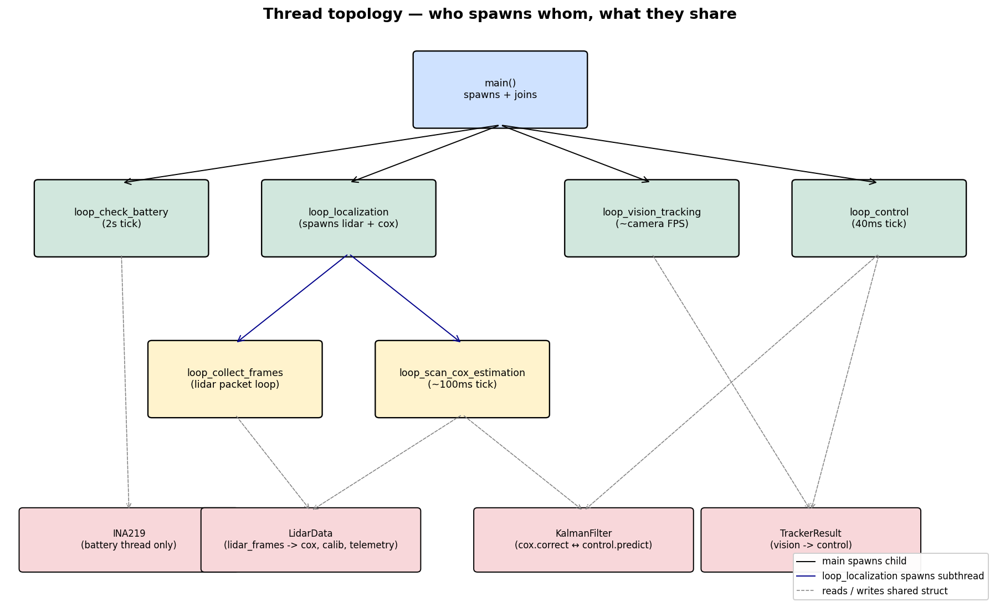
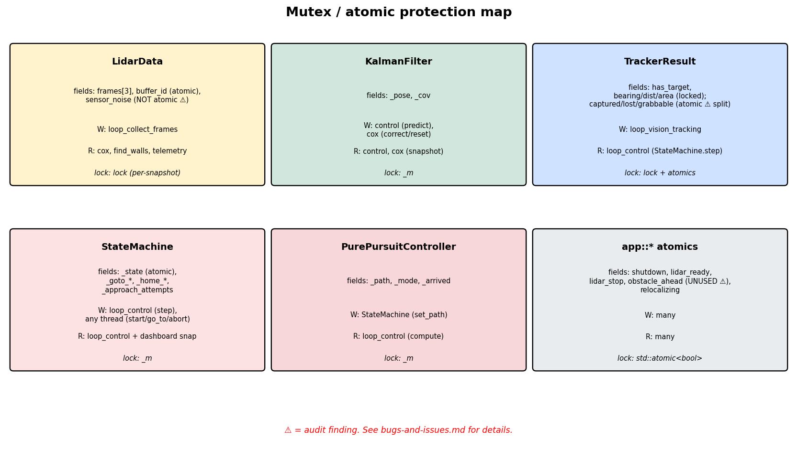

# Architecture — threads, shared state, lifetimes

## Process model

The entire robot runs in a single OS process spawned from
[main.cpp](../../main.cpp). `main()` constructs a small set of shared structs
on its stack, spawns a handful of `std::thread`s, then idles in a
200 ms dashboard-render loop until `app::shutdown` flips (via SIGINT or any
worker that calls `app::shutdown.store(true)`). At shutdown,
`wait_for_threads()` joins every thread before `telemetry::shutdown()` returns.

## The threads

| Thread | Entry point | Cadence | Owner |
|---|---|---|---|
| main | [main.cpp:41](../../main.cpp#L41) | 5 Hz (dashboard render) | — |
| Battery | [src/core.cpp:23 `loop_check_battery`](../../src/core.cpp#L23) | 0.5 Hz | main |
| Localization | [src/core.cpp:67 `loop_localization`](../../src/core.cpp#L67) | drives two sub-threads | main |
| ↳ Lidar frames | [src/utils.cpp:53 `loop_collect_frames`](../../src/utils.cpp#L53) | packet rate (~5 kHz raw, ~10 frames/s) | localization |
| ↳ Cox | [src/cox.cpp:330 `loop_scan_cox_estimation`](../../src/cox.cpp#L330) | 10 Hz (100 ms tick) | localization |
| Vision | [src/tracker.cpp:47 `loop_vision_tracking`](../../src/tracker.cpp#L47) | camera FPS (~12 Hz) | main |
| Control | [src/core.cpp:135 `loop_control`](../../src/core.cpp#L135) | 25 Hz (40 ms tick) | main |

Thread join order (during shutdown) is the spawn order in
[main.cpp:148-174](../../main.cpp#L148-L174): battery → localization → vision →
control. `wait_for_threads()` joins them in that order; localization joins its
own sub-threads internally at
[src/core.cpp:130-132](../../src/core.cpp#L130-L132) before returning.

## Shared state

### LidarData ([include/types.hpp:24-33](../../include/types.hpp#L24))

Triple-buffered LIDAR frames plus a one-shot `sensor_noise` estimate.

- **Writer**: `loop_collect_frames` rotates `buffer_id` (atomic) and writes
  into the now-inactive frame slot.
- **Readers**: `cox.estimate`, `find_walls` (during localization init),
  `get_angle_mapped_lidar_data`, `telemetry::send_state`.
- **Lock**: `LidarData.lock` is acquired by `get_latest_snapshot()` and
  `update_buffer_id()`. The frame-snapshot read pattern is correct.
- **Pitfall**: `sensor_noise` (a plain `double`) is written once by
  `loop_localization` at [src/core.cpp:80-81](../../src/core.cpp#L80-L81) after a
  2-second sleep, then read by `find_walls` at
  [src/calibrations.cpp](../../src/calibrations.cpp) and by `cox.estimate` at
  [src/cox.cpp:74](../../src/cox.cpp#L74). It is not atomic and not under a
  lock — see [bugs-and-issues.md](bugs-and-issues.md#sensor_noise-race).

### KalmanFilter ([include/kalman.hpp](../../include/kalman.hpp))

3-state pose filter (x, y, theta) with full 3×3 covariance.

- **Writer**: `loop_control` calls `predict()` every 40 ms;
  `loop_scan_cox_estimation` calls `correct()` (~10 Hz) and occasionally
  `reset()` after a successful relocalize sweep.
- **Reader**: both threads call `snapshot()` for the dashboard / telemetry.
- **Lock**: single mutex `_m` protects `_pose` and `_cov`. All entry points
  acquire it; reads via `snapshot()` copy under the lock.
- **Caveat**: `predict()` from the 40 ms control loop and `correct()` from
  the 100 ms cox loop serialize on `_m`. There is no deadlock risk because
  `_m` is the only lock either function takes, but a correction can drop
  one or two prediction cycles' worth of process noise on the floor — see
  [data-flow.md](data-flow.md).

### TrackerResult ([include/types.hpp:161-225](../../include/types.hpp#L161))

The camera's view of the box.

- **Writer**: `loop_vision_tracking` (single producer).
- **Reader**: `loop_control` via `StateMachine::step()` → `_vision.get_snapshot()`.
- **Lock**: `lock` protects `has_target`, `bearing_rad`, `distance_mm`,
  `area_px`. `captured`, `lost`, `grabbable` are independent `std::atomic<bool>`.
- **Pitfall**: the three atomics are written independently across
  [src/tracker.cpp:198-250](../../src/tracker.cpp#L198-L250) but
  `get_snapshot()` reads them together. The producer can be preempted between
  two stores, so a reader may observe `captured=true && lost=true`
  momentarily. See [bugs-and-issues.md](bugs-and-issues.md#tracker-atomic-tearing).

### StateMachine ([include/controller.hpp](../../include/controller.hpp))

Mission state + per-state bookkeeping (search waypoints, grip flags,
turn-around accumulator, goto target).

- **Writer/reader**: `step()` is called only from `loop_control`; `start()`,
  `go_to()`, `abort()`, and `configure()` are entry points that can be invoked
  from any thread. All of them acquire `_m` before touching mutable state.
- **`_state`**: `std::atomic<State>`, so reads outside the lock (e.g. the
  dashboard `state_name(_state.load())` at
  [src/controller.cpp:811](../../src/controller.cpp#L811)) are race-free.

### PurePursuitController ([include/pure_pursuit.hpp](../../include/pure_pursuit.hpp))

Stores the path, the `_arrived` flag, and the current lookahead state.

- **Writer**: `StateMachine` via `_controller.set_path()` (on CARRY_HOME entry,
  on GOTO first tick, on SEARCH waypoint transitions, and on the periodic
  CARRY_HOME re-plan).
- **Reader**: `loop_control` via `pp.compute()`.
- **Lock**: `_m` is taken in both `set_path()` and `compute()`. A path swap
  mid-stride does not corrupt the data (each call snapshots under the lock)
  but it does mean a single tick can see an old lookahead and the next tick
  sees the new one.

### `app::*` atomics ([include/global.hpp:25-32](../../include/global.hpp#L25))

| Flag | Set by | Read by | Effect |
|---|---|---|---|
| `shutdown` | `handle_sigint`, any subsystem on hard fault | every loop | clean teardown |
| `lidar_ready` | LIDAR driver after spin-up | `loop_collect_frames` | gates frame collection start |
| `lidar_stop` | LIDAR teardown | `loop_collect_frames` | stops the collection loop |
| `obstacle_ahead` | `loop_collect_frames` | **nobody** | **dead flag — see bugs doc** |
| `relocalizing` | cox before/after sweep | `loop_control` | zeroes motor command |

## Lifetimes and ownership

Everything shared is owned by `main()`'s stack frame and passed by
reference / `std::ref` / `std::cref` to worker threads. Threads are joined
*before* `main()` returns, so no use-after-free is possible **as long as
every loop respects `app::shutdown`** — which they all do.

Two hidden lifetime hazards:

1. **`servo_grab()` is a blocking C call** invoked inside
   `StateMachine::step()` ([src/controller.cpp:594](../../src/controller.cpp#L594)).
   It runs on the `loop_control` thread, so a hang in `servo.c` wedges the
   entire control loop, which in turn never re-checks `app::shutdown` until
   the servo returns. SIGINT will still kill the process on the second hit
   via the `_exit(130)` path in `handle_sigint`, but no clean teardown.
2. **`power_interface` is constructed before `dash.start()`**
   ([main.cpp:137](../../main.cpp#L137)). `configure_voltage_interface()` calls
   `wiringPi` setup; if that fails, `power_interface` is half-constructed and
   the first `supply_voltage()` call from `loop_check_battery` reads garbage.
   The thread shuts the process down on the first non-finite reading
   ([src/core.cpp:33-38](../../src/core.cpp#L33-L38)), which is the right
   recovery but conflates "INA219 not present" with "INA219 broken".

## Build + runtime topology

- Build artefacts land in [build/](../../build/) via `make`; the only
  non-portable dependency is wiringPi, so `make check` (using
  [stubs/](../../stubs/)) compiles every C++ TU but the `servo.c` rule still
  needs the real wiringPi.h.
- Runtime config lives in [config.yml](../../config.yml). The colour-filter
  block is rewritten by `save_filter_result()`
  ([src/calibrations.cpp:317](../../src/calibrations.cpp#L317)); the rest of
  the file is preserved verbatim.
- UDP telemetry to the Matlab viewer is initialised in `main()` before any
  worker spawns, so `telemetry::send_*` from worker threads is always safe.
