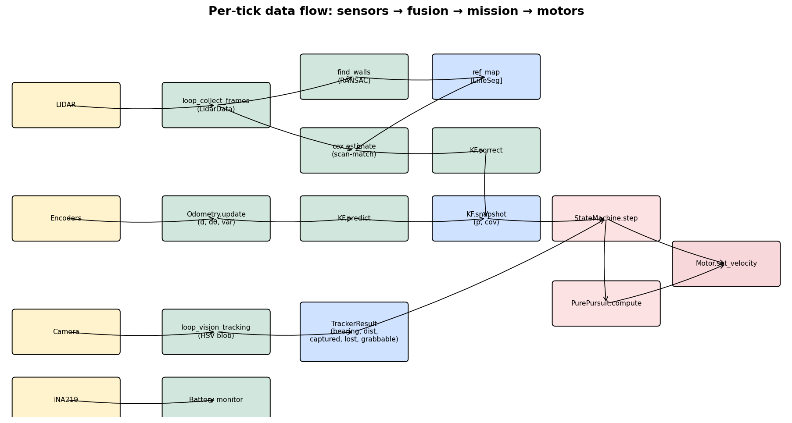
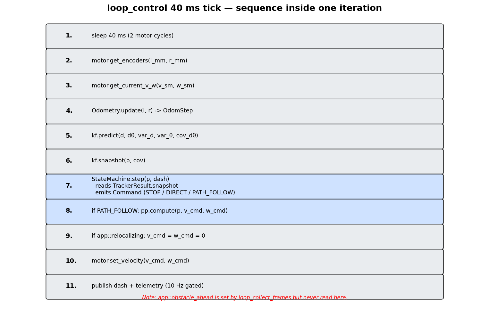

# Data flow — sensors → fusion → mission → motors

This document traces every value that influences the motor command, end to
end. Read it alongside [figures/data_flow.png](figures/data_flow.png) and
[figures/control_tick.png](figures/control_tick.png).

## Big picture

Four independent sensors feed three fusion pipelines that converge on a
single point: `motor.set_velocity(v_cmd, w_cmd)` at
[src/core.cpp:218](../../src/core.cpp#L218).

1. **LIDAR → Cox → KF.correct** at 10 Hz.
2. **Encoders → Odometry → KF.predict** at 25 Hz.
3. **Camera → Tracker → StateMachine** at ~12 Hz (whatever the camera
   delivers).
4. INA219 → battery thread (no influence on motors, only on shutdown).

The KF is the single source of truth for robot pose; the StateMachine reads
it via `kf.snapshot()` at the top of every control tick.

## Per-tick sequence inside `loop_control`

The tick body lives in
[src/core.cpp:166-251](../../src/core.cpp#L166). Every iteration:

1. Sleep 40 ms to let the underlying motor SPI loop tick twice.
2. Read encoder positions: `motor.get_encoders(l_mm, r_mm)` →
   [src/motor.cpp](../../src/motor.cpp).
3. Read the measured wheel velocities (for the dashboard, not the
   controller).
4. `Odometry::update(l_mm, r_mm)` → returns `OdomStep { d_mm, d_theta,
   var_d, var_theta, cov_d_theta, valid }` →
   [src/odometry.cpp](../../src/odometry.cpp).
5. `kf.predict(d_mm, d_theta, var_d, var_theta, cov_d_theta)` advances the
   pose along the unicycle model and inflates `_cov` →
   [src/kalman.cpp](../../src/kalman.cpp).
6. `kf.snapshot(p, cov)` copies pose + covariance under the KF lock.
7. `sm.step(p, dash)` → returns a `Command` with mode `STOP / DIRECT /
   PATH_FOLLOW`. Inside, the state machine reads
   `_vision.get_snapshot()` (the camera) and may also call
   `_controller.set_path()` if the active state needs a new spline.
8. If `mode == PATH_FOLLOW`, `pp.compute(p, v_cmd, w_cmd)` derives the
   velocity command from the current path.
9. If `app::relocalizing.load()` is true, force `v_cmd = w_cmd = 0`.
10. `motor.set_velocity(v_cmd, w_cmd)` (clamped inside the motor driver).
11. Publish dashboard rows; every 100 ms, also push a telemetry frame.

`app::obstacle_ahead` is **not** consulted here — see
[bugs-and-issues.md](bugs-and-issues.md#obstacle_ahead-dead-flag).

## The localization side (cox thread)

The localization thread runs at its own cadence
([src/cox.cpp:330-413](../../src/cox.cpp#L330)). Per cycle:

1. Snapshot the KF pose → use as the Cox seed.
2. Take the latest LIDAR frame snapshot from `LidarData`.
3. Run Cox & Wilfong against the static `ref_map` until it converges or
   gives up.
4. If `cox_can_fuse(est)` is true (`converged && inliers ≥ 6`), call
   `kf.correct(z_pos, z_cov)`.
5. If the KF covariance has blown past `KF_LOST_SIGMA_*`, set
   `app::relocalizing = true`, run a grid-search relocalize sweep, and
   either re-pin the KF with `kf.reset(winner, moderate_recovery_cov())`
   or sleep 500 ms and try again on the next cycle.
6. Publish Cox dashboard rows.

The grid-sweep is the only thing that can produce a non-incremental jump
in pose; everything else is a small KF correction. That is why
`relocalizing` is gated *outside* the StateMachine: once Cox declares the
KF lost, the mission shouldn't keep steering toward a stale lookahead.

## Vision pipeline

`loop_vision_tracking` ([src/tracker.cpp](../../src/tracker.cpp)) produces
six pieces of information:

| Field | Type | Meaning | Consumer |
|---|---|---|---|
| `has_target` + `bearing_rad`, `distance_mm`, `area_px` | bool + 3 doubles, under `lock` | latest detection | StateMachine APPROACH |
| `captured` | atomic bool | held in grip (after CAPTURE_FRAMES hysteresis) | StateMachine APPROACH→CARRY_HOME |
| `lost` | atomic bool | no detection for LOST_FRAMES | StateMachine SEARCH |
| `grabbable` | atomic bool | box fills enough of the bottom region | StateMachine to fire `servo_grab()` |
| `fps`, `frame` | dashboard / video stream | nobody downstream |

The tracker writes `bearing/dist/area` under `lock`, then writes the three
atomic flags in sequence. The reader (`get_snapshot`) acquires `lock`
once and reads the atomics under it — but the writer doesn't, so the read
can observe a stale combination of flags. See
[bugs-and-issues.md](bugs-and-issues.md#tracker-atomic-tearing).

## How vision drives APPROACH

The visual servo loop lives in
[src/controller.cpp:605-657](../../src/controller.cpp#L605). On every
APPROACH tick:

1. Read `_vision.get_snapshot()` once (already done at the top of `step()`).
2. If `snap.has_target`, latch the world-frame box position
   `_last_target_x/y` using `polar_to_world(pose, snap.bearing_rad,
   snap.distance_mm)`.
3. If `snap.grabbable` and the grip has not been fired this attempt, set
   `out.v = 0` for one tick (decel), then fire `servo_grab()` on the next.
4. Otherwise, drive at `_approach_v` with `omega =
   clamp(_approach_k_omega * snap.bearing_rad, ±_approach_omega_max)`.
5. If `!snap.has_target`, dead-reckon toward `_last_target_x/y`. If we
   reach `_dead_reckon_arrival_mm` of that point without re-acquisition,
   bounce back to SEARCH.

The whole APPROACH state is timeout-bounded
([src/controller.cpp:640](../../src/controller.cpp#L640)) so the
dead-reckoning cannot run forever.

## Encoder → odometry → KF.predict (the high-rate path)

[src/odometry.cpp](../../src/odometry.cpp) converts left/right wheel
displacements into `(d, dtheta)`, propagating per-wheel variance through
the unicycle model.

- Input: `l_mm`, `r_mm` (encoder positions in mm, signed).
- Output: `OdomStep { d_mm, d_theta, var_d, var_theta, cov_d_theta,
  valid }`.
- KF model: `x' = x + d·cos(theta + dtheta/2)`,
  `y' = y + d·sin(theta + dtheta/2)`, `theta' = wrap_pi(theta + dtheta)`.

`predict()` propagates `_cov` using the 3×3 Jacobian of the unicycle
model and the 2×2 process noise matrix built from `var_d`, `var_theta`,
`cov_d_theta`. Symmetry is enforced by `from_eigen()` which averages
`(M(i,j) + M(j,i))/2`.

## LIDAR → cox → KF.correct (the corrective path)

[src/cox.cpp](../../src/cox.cpp) implements Cox & Wilfong's scan-match: a
linearised least-squares fit of the live scan to the reference wall map,
iterated until the pose update is small enough. Output:

- `est.pos`: world-frame `(x, y, theta)` estimate.
- `est.sigma_x`, `est.sigma_y`, `est.sigma_a`: 1σ from the inverse of the
  Jacobian-weighted information matrix, scaled by the inlier residual
  variance.
- `est.inliers`, `est.itr`, `est.converged`.

`cox_can_fuse(est)` ([src/cox.cpp:239-255](../../src/cox.cpp#L239)) gates
the correction. If accepted, `z_cov` is the 3×3 from the cox solve and the
KF runs a Joseph-form update.

Two specifics worth knowing:

- The cox solver adds a ridge term (`RIDGE = 1e-3`) to the normal matrix
  before inverting. This stabilises ill-conditioned scans (e.g. a long
  corridor with one wall visible) but artificially shrinks the reported
  covariance. The fused KF gain ends up slightly too high — see
  [bugs-and-issues.md](bugs-and-issues.md#cox-ridge-covariance).
- The KF lost detector is purely covariance-based
  ([src/cox.cpp:377-378](../../src/cox.cpp#L377-L378)). Sustained dead
  reckoning without a cox fix inflates `_cov` past the threshold and
  triggers the relocalize sweep.

## Battery thread (independent)

`loop_check_battery` polls the INA219 every 2 s. Three thresholds:

- `v < BATTERY_PRESENT_MIN_V` for ABSENT_HITS_CAP (~20 s): assume the sensor
  faulted and shut down.
- `v < LOW_BATTERY_LIMIT` for LOW_HITS_NEEDED: log + shut down.
- `v` non-finite: shut down immediately.

The thread has no influence on motors during the run — it only flips
`app::shutdown`.

## Telemetry path

`telemetry::send_state` is called from `loop_control` every ~100 ms with:

- The fused pose + 3×3 cov.
- The "goal" pose — after the recent change, this is the home pose
  (`mission.home_*`).
- `pp.get_active_target()` — the current pure-pursuit lookahead point, or
  a default-constructed `PathPoint` if no path is active. The receiver
  cannot distinguish "no target" from "target at origin" — see
  [bugs-and-issues.md](bugs-and-issues.md#telemetry-default-target).
- The full LIDAR scan (subsampled by `g_subsample`, default 2).

`send_state` writes JSON straight into a UDP datagram. Errors from `sendto`
are ignored — under buffer pressure, packets are silently dropped.
