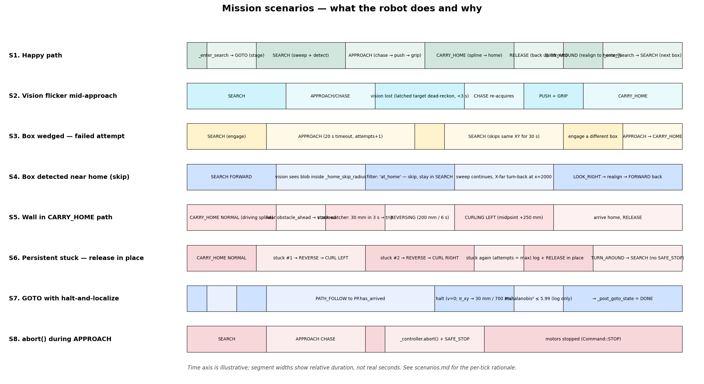

# Mission scenarios — what the robot does and why

This document walks through concrete situations the robot encounters and
explains tick-by-tick how the state machine, vision, lidar gate, and
recovery sub-machines combine to produce the observed behavior. Read
[state-machine.md](state-machine.md) first; this is the "how it plays
out in practice" companion.



The timeline shows relative duration of each phase, not real seconds.
Refer to the per-scenario sections below for actual timing.

---

## S1. Happy path — pick one box, deliver, look for the next

**Setup.** Robot starts at `(0, 0, 0)`. One pink box is in the arena
~1.5 m ahead, no obstacles.

| Phase | What | Why |
|---|---|---|
| `start()` | IDLE → `_enter_search` | The operator armed the mission. `_enter_search` checks staging. |
| Staging | Pose already on the home y-line within tolerance, so `_transition(SEARCH)` directly (no GOTO needed). | `_enter_search` only stages via GOTO when the live pose is off the home line. |
| SEARCH/LOOK_LEFT | CCW at 0.4 rad/s for ~3.9 s | Snapshots `forward_heading_ref` on tick 0; sweeps left half-arc. |
| SEARCH/LOOK_RIGHT | CW until signed Δθ ≤ −π (~7.8 s) | Spans the full back arc; uses signed accumulation rather than absolute target check (wrap-π would falsely trigger at entry). |
| SEARCH/FORWARD | Realign-to-ref (3 ticks stable), then drive 800 mm | The hysteresis prevents Cox jitter from flapping the realign exit. |
| Detection | On a FORWARD tick, vision returns `has_target && !lost`. None of the four skip filters fire (not at home, not behind home, no remembered obstacle in 250 mm, no failed-target memory). | `_search_skip_streak` reset, control hands off. |
| APPROACH/CHASE | v = 30·ROBOT_SPEED, ω = 1.2 · bearing, clamped to ±1.2 rad/s | Bearing P-controller; obstacle bias is zero (no `snap.obstacles` in front of the target). |
| APPROACH/PUSH | First `grabbable` tick latches `_push_active`; drive at 20 mm/s for 30 mm or 2 s | Seats the box between gripper arms; closes too early gave half-grips. |
| APPROACH/STOP TICK | One tick of v = 0 | Lets the wheel speed decay before the servo grabs — otherwise the motion knocks the box. |
| APPROACH/GRIP | `servo_grab()` latches target angle; subsequent ticks hold v = 0 until `servo_done(0)` (~1.6 s) or the 3 s watchdog | Servo slews incrementally in `servo_tick()`; we wait so we don't drag the closing jaws across the box. |
| CARRY_HOME | Plan 3-point B-cubic spline (current → midpoint → home); PATH_FOLLOW | Stuck-watcher armed; obstacle gate active (lidar sits above the box, walls do trigger it). |
| Arrival | `pp.has_arrived()` AND Kalman pose inside `_home_margin` (50 mm) → RELEASE | Two-gate arrival: PP geometric AND KF position. If KF says we're still >margin away, CARRY_HOME re-plans rather than dropping mid-arena. |
| RELEASE | `servo_release()` (in `_transition` entry); v = −50 mm/s for ≥ 4 s | The 4 s window covers the 1.6 s open-slew plus 80 mm of back-up so a subsequent in-place rotation won't snag the released box. |
| TURN_AROUND | P-controller realign to `_home_theta` | Renamed from "180° pivot"; the goal is a consistent SEARCH starting heading, not necessarily a half-turn. |
| `_enter_search` | Back to SEARCH for the next box | Failed-target memory and skip streak are cleared. |

**Total**: ~30–50 s end-to-end depending on box distance and how the
sweep aligns with the box position.

---

## S2. Vision flickers mid-approach

**Setup.** Halfway through CHASE the HSV mask drops the target for
two ticks (lighting flicker, motion blur, partial occlusion).

| Tick | Vision | Action | Why |
|---|---|---|---|
| N | OK | CHASE: latch world XY, drive | `_last_target_valid = true`. |
| N+1 | `lost` | DEAD-RECKON: drive toward latched XY at full chase speed | Re-entering SEARCH on every blip caused the "lose target → rotate → lose new bearing" thrash. As long as we still have a position estimate, keep going. |
| N+2 | `lost` | DEAD-RECKON continues | `_approach_vision_lost_timeout_s` (3 s) hasn't elapsed; no budget charge. |
| N+3 | OK | CHASE resumes, latch fresh XY | `_approach_last_seen_at` refreshed. |
| Later | `grabbable` | PUSH → STOP TICK → GRIP | Normal grip sequence. |

**Outcome.** No retry budget charge. Mission proceeds without operator
visibility (other than a brief `cmd_mode=direct` with constant v, no
omega update on the dashboard).

If the flicker had lasted longer than 3 s, the watchdog
([controller.cpp:993](../../src/controller.cpp#L993)) would have
transitioned directly to SEARCH (no staging) — direct, because vision-lost
loops can burn through `_approach_attempts`, and routing through GOTO each
cycle wastes 1–2 s with no benefit since we're not far off-axis.

---

## S3. Box wedged in the corner — failed attempt

**Setup.** A pink box is jammed against the back wall. APPROACH can
see it but can't seat it in the gripper (it never reports `grabbable`).

| Phase | Time | Action | Why |
|---|---|---|---|
| APPROACH CHASE | 0–20 s | Drives toward the box, ω chases bearing | `grabbable` never fires because the box is past the gripper sweet spot. |
| Timeout | 20 s | `t_in > _approach_timeout_s` → `_approach_attempts++`, latch `_last_failed_target_*` to the latched world XY, → SEARCH | Vision IS up so this counts as a real failed engagement, not a perception gap. |
| SEARCH/sweep | next minute | Same sweep pattern, but `failed-target` filter is active | The 200 mm × 30 s window catches re-detections of the same wedged box. `_search_skip_streak` logs once. |
| New target | (if a different box is in the arena) | Engaged normally | The 200 mm radius keeps it tight enough that a *different* nearby box can still be picked. |
| 30 s later | | `_last_failed_target_valid = false`; the wedged box can be re-tried | If it's still wedged it'll fail again; that's by design (we don't permanently exclude any region). |

**Outcome.** The robot doesn't livelock on an unreachable box for the
whole mission. Old behavior re-engaged the same box every cycle until
either gripper success or operator abort.

---

## S4. Box already at home — skip on detection

**Setup.** During SEARCH on a second mission run, vision sees a pink
blob that's actually the box we delivered last mission.

| Filter | Check | Outcome |
|---|---|---|
| at-home | `det_to_home < _home_skip_radius_mm` (500 mm)? **Yes** | Skip — stay in SEARCH. |
| behind-home | (would also fire if box were on the wall side of home) | n/a |
| obstacle-block | n/a |
| failed-target | n/a |

The log fires once on the rising edge of `_search_skip_streak`; subsequent
ticks while the box stays in view emit nothing. When the sweep moves the
camera off the blob (or the robot rotates past it) the streak resets.
The robot proceeds to FORWARD, possibly hits the X-far turn-back at
`pose.x ≥ 2000 mm`, and continues looking for *new* boxes.

**Why the at-home radius is decoupled from `_home_margin`.** Released
boxes can settle 100–300 mm off the chassis-stop center (rolling, RELEASE
back-up direction). 500 mm covers the realistic drop scatter without
swallowing the entire arena.

---

## S5. Wall in CARRY_HOME path — reverse + curl recovery

**Setup.** The previous mission left a box near home. The current
mission's carry spline aims straight at home, but the parked box
(and/or the home-wall lidar return) trips `app::obstacle_ahead`.

| Phase | Time | Action | Why |
|---|---|---|---|
| CARRY_HOME NORMAL | 0–4 s | Following spline | `_stuck_anchor_pose` advances each tick we move > 30 mm. |
| Wall hit | t=~4 s | Lidar sees a wall ahead; `app::obstacle_ahead = true` | Gate is *not* suppressed in CARRY_HOME (state's obstacle_gate_suppressed() returns false). |
| Velocity gate | t=~4–7 s | `loop_control` zeros forward `v` while keeping `ω` | Lets the controller still rotate if it wants. |
| Stuck detect | t=~7 s | `moved < 30 mm` over the 3 s window → stuck | Sliding window resets every meaningful-displacement tick, so this only fires on *sustained* lack of progress. |
| REVERSING | t=~7–11 s | Direct v = −50 mm/s for 200 mm (or 6 s) | Backs us off the wall in a straight line so we don't drag the carried box across an obstacle. |
| CURLING LEFT | t=~11–25 s | Re-plan spline with midpoint shifted +250 mm left of the start→goal line; PATH_FOLLOW | First curl goes LEFT (sign convention: `+_carry_recovery_curl_offset_mm`). |
| Stuck-watcher in CURLING | continuous | Same 30 mm / 3 s detector | If the curl also wedges, REVERSING starts again with `curl_left = false` → CURLING RIGHT next. |
| Arrival | | `pp.has_arrived` & inside `_home_margin` → RELEASE | Mission accomplished log fires (only on the actual CARRY_HOME→RELEASE edge). |

**Why curl LEFT first then RIGHT.** The carried box approaches home
off-axis on the second attempt — if a previous-delivery box is sitting
to the right, curling LEFT puts our delivery on the empty side. If it's
on the left, the next curl (RIGHT) corrects.

---

## S6. Persistent stuck — release in place rather than abort

**Setup.** Both curl directions fail (e.g. arena badly cluttered or
encoders slipping on a foreign object).

| Attempt | Outcome |
|---|---|
| NORMAL → stuck #1 | REVERSE, CURL LEFT |
| CURL LEFT → stuck #2 | REVERSE, CURL RIGHT |
| CURL RIGHT → stuck again | `_carry_recovery_attempts == _carry_recovery_max_attempts` (2) |
| Branch | Log "stuck again after 2 recovery attempts; releasing in place (X mm from home)", transition to RELEASE | Mission continues — drop the box wherever we are, back up, realign, search for the next one. Old behavior went to SAFE_STOP and required operator restart. |

The 120 s `_carry_timeout_s` is the hard backstop: if the recovery
ping-pong takes longer than 120 s without the stuck-watcher firing
(e.g. constant tiny crawl), SAFE_STOP wins regardless.

---

## S7. Operator GOTO with halt-and-localize

**Setup.** Bench test: operator calls `go_to(1500, 200, π/2)`.

| Tick | Action | Why |
|---|---|---|
| `go_to()` | Latch `_goto_*`, set `_post_goto_state = DONE`, atomic state → GOTO | Plan can't be built here — we don't have the live pose; control thread owns that. |
| First step() | Consume `_goto_pending`; plan 3-point B-cubic spline from `pose` to `(tx, ty, tth)` | If plan fails → SAFE_STOP. |
| PATH_FOLLOW | PurePursuit drives the spline (cruise = 60·ROBOT_SPEED, arrival margin = 40 mm) | TERMINAL_ROTATE enforces final heading at arrival. |
| `pp.has_arrived()` rising edge | Latch `_halting = true`, snapshot `_halt_target_{x,y}`, command STOP | We want a settled KF before declaring arrived — moving covariance is inflated. |
| Halt window | Hold v = 0 until `elapsed ≥ 300 ms AND σ_xy ≤ 30 mm`, OR `elapsed ≥ 700 ms` | Cox folds ~3–5 fresh fixes in while we're stationary; KF shrinks because no odometry noise is being added. |
| Mahalanobis log | Compute χ² of `(target − pose)` under cov; log pass/fail at 5.99 (95 % cut) | **Advisory only** — we always advance. Useful for spotting localization drift in test sweeps. |
| Transition | `_post_goto_state = DONE` → `_transition(DONE, pose)`. `_post_goto_state` reset to DONE so a future chain can't leak from this one. | The chain target is one-shot. |

If the same GOTO is triggered by `_enter_search` instead, the
`_post_goto_state = SEARCH` and the halt-end transitions directly to
SEARCH instead of DONE — the sweep starts from a known geometry every
time.

---

## S8. `abort()` mid-APPROACH

**Setup.** Operator presses an abort key during a chase.

| Tick | Action | Why |
|---|---|---|
| abort() called | (any thread) `_controller.abort()` first, then under `_m` write `_state = SAFE_STOP` | Path cleared even if the `_m` write contends; SAFE_STOP write happens under the lock so dashboard reads see a consistent state. |
| Concurrent step() | If a `_transition()` was in flight, its CAS guard ([controller.cpp:337](../../src/controller.cpp#L337)) detects `_state != old_state` and aborts the transition. | Abort always wins. |
| Next step() | `s == SAFE_STOP` → `Command::STOP`. `loop_control` zeros motors. | No re-entry until `start()` / `start_test()` / `go_to()` is explicitly called again. |

---

## S9. Halt-and-localize Mahalanobis fail (diagnostic)

**Setup.** GOTO arrival; Cox has been quietly diverging (someone moved
a wall, or we're outside the trained ref-map). After the halt:

- `σ_xy = 18 mm` (settled).
- `pose = (1450, 150, π/2)` but target = `(1500, 200, π/2)`.
- Mahalanobis² ≈ `(50²/18² + 50²/18²) ≈ 15.4` (assuming diagonal cov).
- `mahal2 > MAHAL_GATE_CHI2 (5.99)` → log "(FAIL — accepting)".

Mission still advances. The gate is intentionally non-blocking — a
hard reject would require a recovery path we don't have, and the
operator usually wants to see *where* the robot ended up so they can
adjust the ref map or recalibrate. The TEST state ([scenarios above])
prints the same log between every leg, which makes it the cheapest way
to characterize drift across the arena.

---

## S10. Obstacle bias steers around a blocker during APPROACH

**Setup.** A green (non-target) box sits 250 mm in front of the pink
target on the visual axis.

Per-tick computation ([controller.cpp:1055](../../src/controller.cpp#L1055)):

```text
omega_target = 1.2 · bearing                                 # P on target
for obs in snap.obstacles where obs.dist < target.dist
                     and |obs.bearing| < π/2:
    mag = 50 / max(obs.dist_mm, 100)                          # ≈ 0.2 rad/s @ 250 mm
    omega_avoid += -sign(obs.bearing) · mag                   # steer away
omega = clamp(omega_target + omega_avoid, ±1.2)
```

The bias is small (≈ 11°/s at 250 mm) so it perturbs the chase rather
than overpowering it. Far obstacles (>500 mm) contribute < 0.1 rad/s.
Once the obstacle is behind the robot or off the front half-plane
(`|bearing| > π/2`), its term drops out and the chase returns to pure
target-bearing.

The lidar obstacle gate is suppressed in APPROACH — without it, the
gate would zero v whenever the *target itself* entered the obstacle
arc, stalling the grab.

---

## Cross-cutting design notes

- **Why two stuck guards in CARRY_HOME.** The 30 mm / 3 s detector
  catches recoverable wedges (wall, parked box); the 120 s `_carry_timeout_s`
  is the global backstop for pathological cases where the watcher's
  sliding window keeps getting refreshed by tiny crawl.
- **Why the at-home filter uses a half-plane in addition to a radius.**
  A radius alone misses the case where a delivery rolled 600 mm out but
  is still on the *wall side* of home. The half-plane projection
  (`(det − home) · (cos(ht), sin(ht)) < 0`) skips that whole region —
  it's territory we never sweep into during normal operation.
- **Why `_search_omega` is 0.4 rad/s, fixed.** Cox runs at 10 Hz and
  vision at 6 FPS. At 0.4 rad/s ≈ 23°/s the camera sees ~3.8°/frame;
  fast enough to sweep an arc quickly, slow enough that targets get
  caught by the tracker instead of being smeared between frames.
  Scaling with ROBOT_SPEED would couple this safety property to a
  drive-speed knob, which would break perception at high ROBOT_SPEED.
- **Why GOTO/TEST halt before declaring arrived.** PurePursuit's
  geometric arrival fires at the moment the lookahead crosses the goal
  margin — but the KF pose at that instant has fresh odometry noise
  and stale Cox corrections (Cox runs at 100 ms, control at 40 ms).
  The 300–700 ms halt window lets Cox fold in 3–5 corrections without
  any new odometry noise, so the "where did we end up" answer is the
  best the localizer can give.
- **Why the controller never SAFE_STOPs on SEARCH.** Operationally the
  mission was always meant to keep trying until SIGINT, and SAFE_STOP
  on a 60 s sweep timeout was the most common complaint from the lab
  team. The diagnostics (`_search_timeout_s`, `_max_approach_attempts`)
  still log on the crossing tick so issues are visible without being
  fatal.
