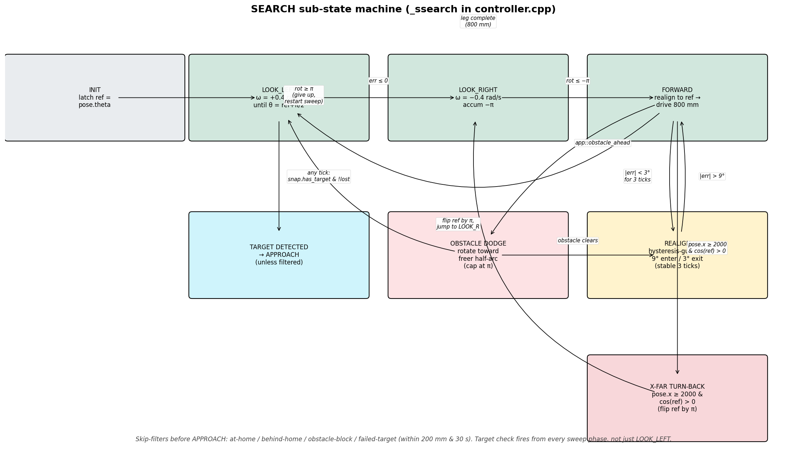
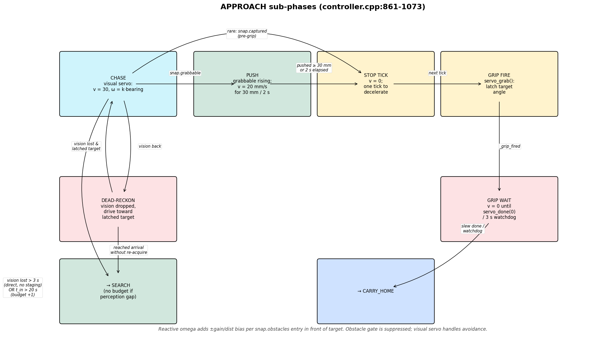
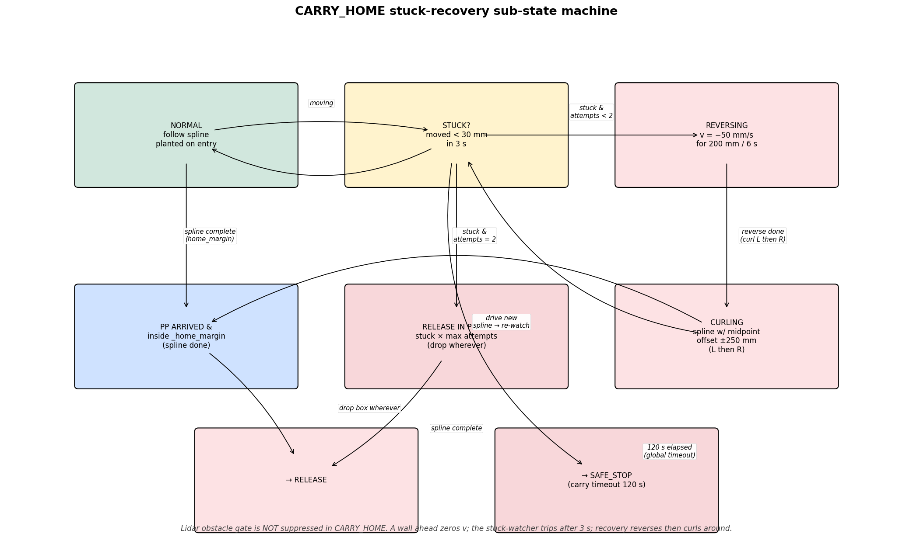

# Mission state machine

The whole mission lives in [src/controller.cpp](../../src/controller.cpp)
(~1500 lines). [`StateMachine::step()`](../../src/controller.cpp#L455) is
called once per control tick (40 ms) from `loop_control` and returns a
`Command` that says either "stop", "use this (v, ω) directly", or
"follow the path I just loaded".

A `Command::STOP` doesn't always mean the robot is *idle* — STOP is also
emitted as a placeholder while a state is mid-transition or mid-handoff
(e.g. on the tick that fires `_transition`). Look at the *new* state to
know what comes next.

## Top-level states and transitions

| State | Purpose | Primary exits |
|---|---|---|
| `IDLE` | Boot state. Motors stopped. | `start()` → SEARCH (via `_enter_search`); `go_to()` → GOTO; `start_test()` → TEST |
| `SEARCH` | Fixed-axis look-left / look-right / forward sweep, with adaptive obstacle dodge and a hysteresis-guarded realign. Engages a target when vision sees one that isn't filtered out. | engageable target → APPROACH; `snap.captured` (somehow already holding a box) → CARRY_HOME |
| `APPROACH` | Visual-servo toward the box, dead-reckon on brief vision dropouts, push-then-grip when grabbable, wait for servo slew. | grip done → CARRY_HOME; vision lost > 3 s → SEARCH (no budget charge); approach timeout (20 s) → SEARCH (budget +1, target memorized as failed); dead-reckon arrival without re-acquire → SEARCH |
| `CARRY_HOME` | Spline + pure-pursuit to home, with a stuck-recovery sub-machine (NORMAL ↔ REVERSING → CURLING). | `pp.has_arrived` & inside `_home_margin` → RELEASE; carry timeout (120 s) → SAFE_STOP; stuck after max curl attempts → RELEASE in place |
| `RELEASE` | `servo_release()` then back up `_release_seconds` (4 s) at `_release_v` (-50 mm/s) to clear the box. | `t_in ≥ _release_seconds && !captured` → TURN_AROUND; hard timeout (5 s) → TURN_AROUND |
| `TURN_AROUND` | P-controller in-place rotation to `_home_theta` (re-named REALIGN in logs; still uses the same enum). | `|θ − _home_theta| < 3°` → `_enter_search`; `_turn_around_timeout_s` (8 s) → `_enter_search` |
| `GOTO` | Drive to a latched `(x, y, θ)` via 3-point B-cubic spline + pure-pursuit, then halt-and-localize before declaring arrival. | halt settles → `_post_goto_state` (DONE or SEARCH); plan failure → SAFE_STOP |
| `TEST` | Walk a hardcoded 3-leg waypoint list (forward 400 mm, +90° + 300 mm, back to origin); halt-and-localize between legs. | all legs done → DONE; plan failure → SAFE_STOP |
| `DONE` | Mission complete. Motors stopped. | `start()` / `start_test()` / `go_to()` re-arm. |
| `SAFE_STOP` | Aborted. Motors stopped. | Same re-arm paths as DONE. |

## Entry points

| Method | Allowed from | Effect |
|---|---|---|
| `configure(home_x, home_y, home_theta, home_margin, arm_length)` | any | Latches mission geometry under `_m`. Must be called once before `start()`. |
| `start()` | IDLE / DONE / SAFE_STOP | Reset `_approach_attempts`, clear failed-target memory, go to SEARCH via `_enter_search`. |
| `start_test()` | IDLE / DONE / SAFE_STOP | Reset `_test_step`, mark `_test_replan_needed`, go to TEST. |
| `go_to(x, y, θ)` | IDLE / DONE / SAFE_STOP / GOTO | Latch `_goto_*`, set `_post_goto_state = DONE`, go to GOTO. Spline is built on the *next* `step()` because the live pose lives on the control thread. Replaces any un-consumed pending target. |
| `abort()` | any | `_controller.abort()` clears the path, then transition to SAFE_STOP. CAS-protected against a concurrent `_transition`. |

`_state` is `std::atomic<State>` so `state()` is lock-free, but every
write goes through `_m`. The atomic is the read path; the mutex is the
synchronization path. `_transition()` includes a CAS guard
([controller.cpp:337](../../src/controller.cpp#L337)) so a concurrent
`abort()` always wins over an in-flight state change.

## SEARCH sub-state machine

SEARCH is **not** a single behavior — it runs a small phase loop
inside `_ssearch` ([controller.hpp:168](../../include/controller.hpp#L168)):

1. **LOOK_LEFT** — CCW rotate in place at `_search_omega` (0.4 rad/s) until
   `θ = forward_heading_ref + π/2`.
2. **LOOK_RIGHT** — CW rotate at `−_search_omega`, integrating signed Δθ,
   until the accumulated rotation reaches −π (i.e. a full half-turn from
   the LEFT extreme through the back of the robot).
3. **FORWARD** — realign to `forward_heading_ref` under a hysteresis gate
   (`enter > 9°`, `exit < 3°`, must hold for 3 ticks), then drive forward
   at `_search_v_forward_mm_s` for `_search_forward_target_mm` (800 mm).
   Loop back to LOOK_LEFT.

`forward_heading_ref` is **snapshotted once** at first-tick init and
held for the whole SEARCH entry — the sweep stays anchored to one axis
instead of drifting around the arena.

### SEARCH side-quests during FORWARD

- **Obstacle dodge** ([controller.cpp:732](../../src/controller.cpp#L732)):
  if `app::obstacle_ahead` fires, pick a rotation direction once
  (toward the freer half-arc per `app::obstacle_{left,right}_mm`), rotate
  while accumulating Δθ. If we hit `_search_obstacle_max_rotation_rad`
  (π) without clearing, abandon the leg and restart from LOOK_LEFT.
  Otherwise drop into realign-to-ref once the obstacle clears.
- **X-far turn-back** ([controller.cpp:822](../../src/controller.cpp#L822)):
  if `pose.x ≥ _search_x_far_turn_mm` (2000 mm) *and* the heading
  reference still points into the arena (`cos(ref) > 0`), flip the
  reference 180° and restart the sweep from LOOK_RIGHT. One-shot per
  SEARCH entry (the `cos()` guard prevents re-flipping on the way back).
- **Realign hysteresis** ([controller.cpp:772](../../src/controller.cpp#L772)):
  any heading error above `_search_realign_enter_rad` (~9°) latches
  `in_realign=true`. Exit requires |err| < `_search_realign_exit_rad`
  (~3°) for 3 consecutive ticks. Kills the L/R/FWD flap caused by Cox
  jitter near the deadband.

### SEARCH target-engagement filters

When vision sees a target (`!lost && has_target`), SEARCH *doesn't* always
engage. Three skip filters fire in order:

| Filter | Rule | Why |
|---|---|---|
| **at-home** | `det_to_home < _home_skip_radius_mm` (500 mm) | Box sits in the drop zone — it's almost certainly one we already delivered. |
| **behind-home** | Half-plane: project `(det − home)` onto `(cos(_home_theta), sin(_home_theta))`. Negative ⇒ box is on the wall side of home. | We never sweep into that half-plane during a normal mission, so a detection there is wall reflection or a stale delivery, not a target. |
| **obstacle-block** | Any remembered obstacle within `_obstacle_block_radius_mm` (250 mm) of the detection | The blocker would foul the grab. Catches chain-push cases before APPROACH starts. |
| **failed-target** | Within `_failed_target_skip_radius_mm` (200 mm) of a previously-failed target AND inside `_failed_target_skip_s` (30 s) | Breaks the SEARCH → APPROACH → timeout → SEARCH livelock when a box is wedged or otherwise unreachable. |

Logs only fire on the rising edge (`_search_skip_streak`). A new
non-skipped detection resets the streak and hands off to APPROACH.

`_search_timeout_s` (60 s) is retained for diagnostics only — SEARCH
runs indefinitely until SIGINT, per design. The `_approach_attempts`
budget likewise no longer aborts (logs only on the crossing tick).

## APPROACH sub-phases

APPROACH cycles through four logical phases on each tick depending on
vision + servo state ([controller.cpp:861](../../src/controller.cpp#L861)):

1. **Chase** — visual-servo: `ω = clamp(_approach_k_omega · bearing, ±_approach_omega_max)`,
   `v = _approach_v` (30·ROBOT_SPEED mm/s). Reactive obstacle bias:
   each `snap.obstacles` entry in front of the target on the visual
   axis adds `omega_avoid = ±_approach_repulsion_gain / max(dist, 100)`
   away from its bearing.
2. **Push** ([controller.cpp:938](../../src/controller.cpp#L938)) — on
   the first `grabbable` tick, latch `_push_active`, drive at
   `_approach_push_v` (20 mm/s) until either
   `_approach_push_distance_mm` (30 mm) traveled or
   `_approach_push_timeout_s` (2 s) elapsed. Seats the box between the
   gripper arms before closing.
3. **Stop tick** — one tick of `v = 0` (`_grip_stop_sent = true`) so the
   motor decelerates before the servo latches.
4. **Grip + slew wait** ([controller.cpp:882](../../src/controller.cpp#L882))
   — `servo_grab()` latches the target angle; `_grip_fired = true`.
   Hold `v = ω = 0` until `servo_done(0)` reports the jaws finished
   slewing (full 1.6 s) or the 3 s grip watchdog fires. Then →
   CARRY_HOME.

A rare branch ([controller.cpp:910](../../src/controller.cpp#L910)):
if `snap.captured` rises *before* `grabbable` (box drifted inside the
capture ROI), the same stop-tick → `servo_grab` sequence runs so the
jaws actually close — historically this short-circuited straight to
CARRY_HOME with an open gripper.

### APPROACH exits

| Condition | Branch | Effect on retry budget |
|---|---|---|
| `_grip_fired && (servo_done OR 3 s watchdog)` | → CARRY_HOME | Resets `_approach_attempts` to 0 |
| Vision lost continuously > `_approach_vision_lost_timeout_s` (3 s) | → SEARCH (direct, no staging) | No charge — perception gap, not a failed engagement |
| Vision dropped, no latched target | → SEARCH | No charge |
| Vision dropped, reached dead-reckon arrival without re-acquire | → SEARCH | No charge |
| `t_in > _approach_timeout_s` (20 s) with vision still up | → SEARCH | **Budget +1**; latch `_last_failed_target_*` so SEARCH skips the same world-frame position for 30 s |

`_grip_stop_sent` and `_push_active` are reset whenever the gate
condition (`!_grip_fired && !captured && !grabbable`) holds — prevents a
stray frame of `captured`/`grabbable` from leaving the latches stale and
skipping the deceleration tick on the *next* real grip.

## CARRY_HOME sub-state machine

`_carry_phase` ([controller.hpp:403](../../include/controller.hpp#L403))
runs a stuck-recovery sub-machine on top of the normal spline follower:

- **NORMAL** — drive the spline planted on entry. Watch a sliding window:
  if pose displacement stays below `_carry_stuck_dist_threshold_mm`
  (30 mm) for `_carry_stuck_window_s` (3 s), declare stuck.
  - Stuck & under attempt cap → abort path, → REVERSING.
  - Stuck & at `_carry_recovery_max_attempts` (2) → log, → RELEASE in
    place (drop the box wherever we are, with `dist_to_home` logged).
- **REVERSING** — direct backward at `_carry_recovery_reverse_v` (50 mm/s)
  until either `_carry_recovery_reverse_mm` (200 mm) covered or
  `_carry_recovery_reverse_timeout_s` (6 s) hits. Then plan a curled
  spline with the midpoint offset `_carry_recovery_curl_offset_mm`
  (250 mm) left or right (first curl LEFT, second RIGHT), → CURLING.
- **CURLING** — follow the off-axis spline. Same stuck-watcher as NORMAL;
  if it trips again, increment the attempt counter and either re-enter
  REVERSING or fall through to RELEASE in place.

### Other CARRY_HOME branches

- **Entry-plan retry** ([controller.cpp:1086](../../src/controller.cpp#L1086))
  — `_transition(CARRY_HOME)` tries to plan; on failure it leaves
  `_controller` path-less and the step body re-plans every tick.
  No SAFE_STOP on a transient spline failure.
- **Pure-pursuit arrived but Kalman is still far from home**
  ([controller.cpp:1102](../../src/controller.cpp#L1102)) — re-plan
  straight to home rather than stranding the box mid-arena.
- **`_carry_timeout_s` (120 s)** → SAFE_STOP.

## RELEASE

[controller.cpp:1244](../../src/controller.cpp#L1244)

- `servo_release()` on entry (in `_transition`), then drive backward at
  `_release_v` (−50 mm/s) for at least `_release_seconds` (4 s).
- Exit on `t_in ≥ _release_seconds && !snap.captured` → TURN_AROUND.
- Hard timeout `_release_hard_timeout_s` (5 s) → TURN_AROUND regardless
  (handles the tracker holding a stale `captured` on a static pink blob).

## TURN_AROUND (REALIGN)

[controller.cpp:1267](../../src/controller.cpp#L1267)

- Despite the name, this is no longer "180° pivot" — it's a P-controller
  realignment to `_home_theta`: `ω = clamp(2 · wrap_pi(home_theta − θ), ±1.0)`.
- Exit: |delta| < 3° → `_enter_search`, or `_turn_around_timeout_s` (8 s) →
  `_enter_search` (bail-out so a motor jam can't wedge the mission —
  the old "no hard timeout" bug from the original audit).

## GOTO

[controller.cpp:1294](../../src/controller.cpp#L1294)

- First tick after entry consumes `_goto_pending`, plans a 3-point B-cubic
  spline to the latched target; failure → SAFE_STOP.
- On `pp.has_arrived()`, latch `_halting = true` and start a halt-and-
  localize window. During the halt:
  - Wait until `elapsed ≥ HALT_MIN_MS` (300 ms) **and** `σ_xy ≤ 30 mm`,
    OR `elapsed ≥ HALT_MAX_MS` (700 ms).
  - Compute Mahalanobis² of `(target − pose)` under the xy-cov block.
    Log pass/fail against χ² ≥ 5.99 (95 % gate for 2 DoF). The gate is
    **advisory** — we always advance; this is for diagnostics, not control.
  - Transition to `_post_goto_state` (DONE for an external `go_to()`,
    SEARCH for an `_enter_search()` chain).

## TEST

[controller.cpp:1366](../../src/controller.cpp#L1366)

- Walks `TEST_WAYPOINTS[]` (3 legs hardcoded in `controller.cpp:41`).
- Same halt-and-localize gate between legs as GOTO.
- All legs complete → DONE.

## `_enter_search` staging

[controller.cpp:350](../../src/controller.cpp#L350)

Any time the mission wants to enter SEARCH, it goes through `_enter_search`
instead of `_transition(SEARCH, ...)` directly. The staging logic:

1. Compute `dist_from_home`. If `> _search_far_threshold_mm` (3400 mm),
   pick `stage_theta = π` (face back toward home); else `stage_theta = 0`
   (face into the arena).
2. Clamp `stage_x` to `[_search_stage_x_min_mm, _search_stage_x_max_mm]`
   = [300, 2000]; `stage_y = _home_y`.
3. If the live pose is already inside the staging tolerance (`x_ok &&
   y_ok && |θ−stage_theta| < _search_stage_theta_tol`), `_transition`
   to SEARCH directly.
4. Otherwise latch a GOTO target with `_post_goto_state = SEARCH` and
   `_transition` to GOTO. After GOTO halts, SEARCH starts from a known
   geometry.

Practical effect: every SEARCH entry starts from the home y-line with a
predictable heading. The sweep pattern stays repeatable across the
mission and after each delivery.

## Obstacle-gate suppression

`obstacle_gate_suppressed()` ([controller.cpp:222](../../src/controller.cpp#L222))
tells `loop_control` whether to honor the lidar forward-arc obstacle gate
this tick:

- **APPROACH** suppressed — the visual servo with reactive omega over
  `snap.obstacles` is the avoidance strategy; the lidar gate would zero
  v whenever the target itself entered the obstacle arc and stall the
  grab.
- **RELEASE / TURN_AROUND** suppressed — backward / in-place rotation;
  the forward-velocity gate is a no-op there, but suppressing keeps
  intent explicit.
- **CARRY_HOME and SEARCH** *not* suppressed — the lidar mount sits
  above the boxes so the held payload doesn't pin the gate; walls do.
  CARRY_HOME relies on this: when forward motion is zeroed by a wall
  ahead, the stuck-recovery sub-machine reverses and re-plans around
  the obstruction.

## Obstacle world memory

[controller.cpp:483](../../src/controller.cpp#L483)

On every tick, project each `snap.obstacles` observation into world
coordinates. Merge with the nearest existing entry of the same `color_id`
within `_obstacle_merge_radius_mm` (200 mm) via EMA (α = 0.35), or
append a fresh entry. Drop entries older than `_obstacle_forget_s`
(30 s). The map feeds the SEARCH **obstacle-block** filter and the
APPROACH reactive avoidance bias.

## Key timers and tunables

All defaults live in [include/controller.hpp:288-416](../../include/controller.hpp#L288).

| Tunable | Default | Notes |
|---|---|---|
| `_search_omega` | 0.4 rad/s | Fixed (not ROBOT_SPEED-scaled). Bounded by Cox 10 Hz + vision 6 FPS. |
| `_search_v_forward_mm_s` | 50·ROBOT_SPEED | FORWARD-leg cruise. |
| `_search_forward_target_mm` | 800 mm | FORWARD leg length per sweep cycle. |
| `_search_obstacle_max_rotation_rad` | π | Half-turn cap on a single obstacle clear. |
| `_search_realign_enter_rad / exit_rad / stable_ticks` | 0.15 / 0.05 / 3 | Hysteresis around `forward_heading_ref`. |
| `_search_x_far_turn_mm` | 2000 mm | X threshold for in-sweep U-turn. |
| `_search_far_threshold_mm` | 3400 mm | Staging heading flip (face-home vs face-arena). |
| `_approach_v` | 30·ROBOT_SPEED | Visual-servo cruise. |
| `_approach_k_omega` | 1.2 | Bearing-P gain; lowered from 1.8 to stay inside camera HFOV slew. |
| `_approach_omega_max` | 1.2 rad/s | Fixed clamp. |
| `_approach_repulsion_gain` | 50 | rad/s · mm; ≈ 0.2 rad/s bias at 250 mm. |
| `_approach_push_v / distance / timeout` | 20 mm/s / 30 mm / 2 s | Push-then-grip. |
| `_approach_vision_lost_timeout_s` | 3 s | APPROACH watchdog for continuous vision loss. |
| `_dead_reckon_arrival_mm` | 100 mm | Give-up distance with no re-acquire. |
| `_approach_timeout_s` | 20 s | Per-attempt approach timeout (charges retry budget). |
| `_release_v / seconds / hard_timeout_s` | −50 mm/s / 4 s / 5 s | Backup-and-clear. |
| `_turn_around_timeout_s` | 8 s | REALIGN bail to SEARCH. |
| `_carry_timeout_s` | 120 s | Global CARRY_HOME timeout → SAFE_STOP. |
| `_carry_stuck_dist_threshold_mm / window_s` | 30 mm / 3 s | Sliding-window stuck detection. |
| `_carry_recovery_reverse_mm / v / timeout_s` | 200 mm / 50 mm/s / 6 s | REVERSING phase. |
| `_carry_recovery_curl_offset_mm` | 250 mm | Lateral midpoint offset for CURLING. |
| `_carry_recovery_max_attempts` | 2 | After this many failed curls, RELEASE in place. |
| `_home_skip_radius_mm` | 500 mm | At-home target-skip radius. |
| `_obstacle_merge_radius_mm / forget_s / block_radius_mm` | 200 mm / 30 s / 250 mm | Obstacle map. |
| `_failed_target_skip_radius_mm / s` | 200 mm / 30 s | Failed-target memory. |
| `HALT_MIN_MS / MAX_MS / SIGMA_XY_TARGET_MM / MAHAL_GATE_CHI2` | 300 / 700 / 30 / 5.99 | Halt-and-localize. |
| `_planned_v_max_mm_s / _planned_margin_mm` | 60·ROBOT_SPEED / 40 mm | Shared spline-leg cruise + arrival. |

## Things to know before editing

1. **Always call `configure()` before `start()`** — the controller has
   no internal default for the home pose, only the constructor's. The
   `MissionConfig` struct in [src/core.cpp:158](../../src/core.cpp#L158)
   does this.
2. **`step()` may call `_controller.set_path()` and `servo_grab()`** —
   both block briefly. `set_path()` acquires the pure-pursuit lock;
   `servo_grab()` only latches a target angle now (the slew is incremental
   via `servo_tick()` on each control tick), so it's no longer a 1.2 s
   block — the `_grip_fired` branch waits for `servo_done(0)` instead.
3. **Path-failure on entry is non-fatal for CARRY_HOME** — the step body
   retries the plan each tick. Dashboard `cmd_mode` shows `stop` during
   the retry.
4. **SEARCH no longer self-aborts.** `_search_timeout_s` and
   `_max_approach_attempts` log on the crossing tick but never SAFE_STOP.
   SIGINT is the only stop.
5. **TURN_AROUND is REALIGN-to-`home_theta`**, not a 180° pivot. The
   enum name is unchanged for ABI reasons; logs and behavior changed.
6. **GOTO/TEST always halt-and-localize before declaring arrival.** Any
   external caller that relies on `goto_arrived()` will see a 0.3–0.7 s
   delay after PurePursuit's geometric arrival.
7. **The Mahalanobis gate is advisory.** It logs pass/fail but the
   transition always fires — useful for diagnostics, not control.
