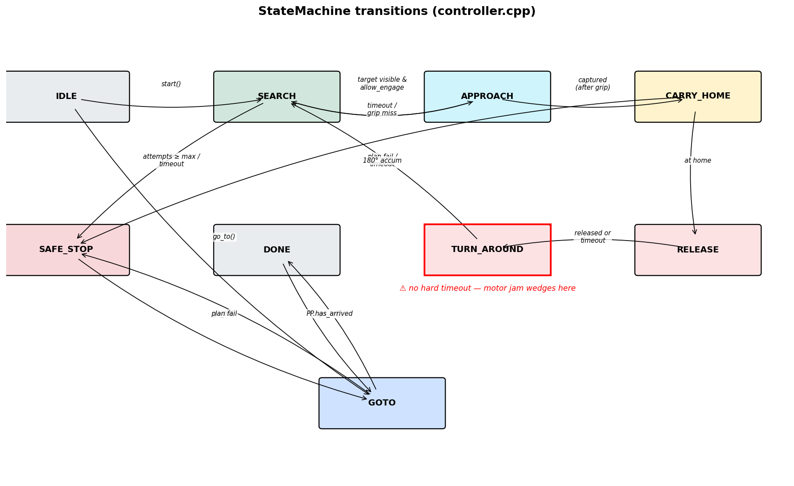

# Mission state machine

The whole mission lives in
[src/controller.cpp](../../src/controller.cpp) (~830 lines).
[`StateMachine::step()`](../../src/controller.cpp) is called once per control
tick (40 ms) from `loop_control` and returns a `Command` that says either
"stop", "use this (v, omega) directly", or "follow the path I just loaded".

## States and transitions

| State | Purpose | Exit conditions |
|---|---|---|
| IDLE | Boot state. Motors stopped. | `start()` → SEARCH; `go_to()` → GOTO |
| SEARCH | Adaptive-subdivision waypoint sweep, rotating in place between waypoints to scan for a box. | target visible & dwell elapsed → APPROACH; attempts exhausted / timeout → SAFE_STOP |
| APPROACH | Visual-servo toward the box, dead-reckon during vision dropouts, fire `servo_grab()` when grabbable. | `captured` debounced → CARRY_HOME; timeout / grip miss / dead-reckon fail → SEARCH |
| CARRY_HOME | Spline + pure-pursuit toward the home pose, re-planning every 5 s. | `pp.has_arrived()` → RELEASE; plan failure / timeout → SAFE_STOP |
| RELEASE | Open the gripper, back up `_release_seconds` at `_release_v`. | `!captured` debounced or timeout → TURN_AROUND |
| TURN_AROUND | 180° in-place pivot so the camera looks away from the just-delivered box. | accumulated rotation ≥ π → SEARCH |
| DONE | Mission complete. Motors stopped. | `start()` → SEARCH; `go_to()` → GOTO |
| SAFE_STOP | Aborted. Motors stopped. | `start()` → SEARCH; `go_to()` → GOTO |
| GOTO | Lab/bench: drive to one (x, y, theta) via spline + pure-pursuit. | `pp.has_arrived()` → DONE; plan failure → SAFE_STOP |

TURN_AROUND has no hard timeout. If the motor jams or the robot can't
rotate, the loop stays in TURN_AROUND indefinitely. See
[bugs-and-issues.md](bugs-and-issues.md#turn_around-no-timeout).

## Entry points

| Method | Allowed from | Effect |
|---|---|---|
| `configure(home_x, home_y, home_theta, home_margin, arm_length)` | any | latches mission geometry under `_m`. Must be called once before `start()`. |
| `start()` | IDLE / DONE / SAFE_STOP | reset `_approach_attempts`, transition to SEARCH. |
| `go_to(x, y, theta)` | IDLE / DONE / SAFE_STOP / GOTO | latch `_goto_*`, set `_goto_pending`, transition to GOTO. Spline is built on the next `step()` because the live pose lives on the control thread. |
| `abort()` | any | transition to SAFE_STOP; `_controller.abort()` clears the path. |

`_state` is `std::atomic<State>` so `state()` is lock-free, but every
write goes through `_m`. The atomic is the read path; the mutex is the
synchronization path.

## Per-state details

The full step function is too long to reproduce here; this section
summarises the decisions each state makes.

### IDLE
- Command: STOP.
- Waits for an external `start()` or `go_to()`.

### SEARCH
[src/controller.cpp:395-501](../../src/controller.cpp#L395)

- Builds an adaptive waypoint plan from
  `calib::get_arena_bounds()` if not already valid.
- Iterates waypoints, "travelling" (path-follow) → "rotating" at each
  waypoint (DIRECT, ω = `_search_omega`).
- During the rotate phase, looks at vision. If `has_target && !at-home &&
  allow_engage`, transitions to APPROACH.
- "At-home" filter: if the detected box is already inside the home
  margin, log once and skip it (so the robot doesn't grab a box it just
  delivered). Implemented via `_search_skip_streak`.

Timeouts:
- `_search_timeout_s` (60 s) → SAFE_STOP.
- `_approach_attempts ≥ _max_approach_attempts (5)` → SAFE_STOP.

### APPROACH
[src/controller.cpp:539-657](../../src/controller.cpp#L539)

- Visual servo: `omega = clamp(_approach_k_omega * snap.bearing_rad,
  ±_approach_omega_max)`, `v = _approach_v`.
- Latches the world-frame target on every tick with valid vision; uses
  the latch for dead-reckoning during dropouts.
- Grip sequence (3-tick handshake):
  1. tick N: see `grabbable`, set `out.v = 0`, set `_grip_stop_sent = true`.
  2. tick N+1: call `servo_grab()` (blocking, ~1.2 s), set `_grip_fired = true`.
  3. tick N+2..: wait for `captured` debounce; on success → CARRY_HOME, on
     timeout → release + retry budget +1 → SEARCH.

Timeouts:
- `_approach_timeout_s` (20 s) → increment budget → SEARCH.
- Dead-reckon arrival (`_dead_reckon_arrival_mm`, 100 mm) without
  re-acquisition → SEARCH.

### CARRY_HOME
[src/controller.cpp:678-720](../../src/controller.cpp#L678)

- `_plan_path_home()` builds a 3-point B-cubic spline (current → midpoint
  → home) on entry and re-builds every `_carry_replan_s` (5 s).
- The path goal is biased back by `_arm_length_mm` so the *box* lands at
  `home_*`, not the robot.
- Follows the path; transition on `pp.has_arrived()`.

Timeouts:
- `_carry_timeout_s` (90 s) → SAFE_STOP.
- Spline failure → SAFE_STOP.

### RELEASE
[src/controller.cpp:721-728](../../src/controller.cpp#L721)

- `servo_release()` once, then drive backward at `_release_v` (-40 mm/s) for
  `_release_seconds` (1.25 s).
- `_release_hard_timeout_s` (5 s) is the hard guard against a stuck box.
- Exit: `!captured` debounced or timeout → TURN_AROUND.

### TURN_AROUND
[src/controller.cpp:731-757](../../src/controller.cpp#L731)

- On entry, latch `_turn_start_theta`, set `_turn_accumulated = 0`.
- Drive `(v, omega) = (0, _search_omega)`.
- Per tick, add `|wrap_pi(pose.theta - _turn_start_theta)|` to
  `_turn_accumulated`, then update `_turn_start_theta = pose.theta`.
- Exit when `_turn_accumulated ≥ π`. **No time-bounded escape.**

### DONE / SAFE_STOP
- Both emit Command::STOP.
- Both allow re-entry into SEARCH via `start()` or GOTO via `go_to()`.

### GOTO
[src/controller.cpp:759-789](../../src/controller.cpp#L759)

- On first tick after `go_to()`, build a single spline to the latched
  target. The spline goal is *not* biased by `_arm_length_mm` (this is
  for lab navigation, not box delivery).
- Follow path; transition on `pp.has_arrived()` → DONE.

## Key timers and tunables

All defaults live in [include/controller.hpp:150-174](../../include/controller.hpp#L150).

| Tunable | Default | Notes |
|---|---|---|
| `_search_omega` | 0.35 * ROBOT_SPEED rad/s | ~20°/s, slow enough for vision frames |
| `_search_min_dwell_s` | 2.0 s | bounce guard between APPROACH retries |
| `_search_v_max_mm_s` | 40 * ROBOT_SPEED | travel between waypoints |
| `_waypoint_margin_mm` | 80 mm | arrival radius at each search waypoint |
| `_box_detection_range_mm` | 700 mm | drives adaptive subdivision |
| `_grip_settle_s` | 1.0 s | wait for `captured` to debounce after servo close |
| `_approach_v` | 30 * ROBOT_SPEED | visual-servo cruise |
| `_approach_k_omega` | 1.8 | rad/s per rad of bearing error |
| `_approach_omega_max` | 1.2 * ROBOT_SPEED | clamp on steering rate |
| `_dead_reckon_arrival_mm` | 100 mm | fallback give-up distance |
| `_release_v` | -40 mm/s | backward speed during release |
| `_release_seconds` | 1.25 s | ~50 mm back-up at 40 mm/s |
| `_release_hard_timeout_s` | 5.0 s | give up if the box stays on the arm |
| `_search_timeout_s` | 60.0 s | global search timeout |
| `_approach_timeout_s` | 20.0 s | per-attempt approach timeout |
| `_carry_timeout_s` | 90.0 s | global carry timeout |
| `_carry_replan_s` | 5.0 s | CARRY_HOME re-plan cadence |
| `_max_approach_attempts` | 5 | mission abort after this many APPROACH failures |

## Things to know before editing

1. **Always call `configure()` before `start()`** — the controller has
   no internal default for the home pose, only the constructor's. The new
   `main.cpp` does this via the `MissionConfig` struct
   ([src/core.cpp:158-160](../../src/core.cpp#L158)).
2. **`step()` may call `_controller.set_path()` and `servo_grab()`** —
   both block. `set_path()` briefly acquires the pure-pursuit lock;
   `servo_grab()` blocks the control thread for ~1.2 s. Plan around it
   if you rate-limit something.
3. **Path failures are silent except for the log line.** If
   `_plan_path_home()` returns false, the state machine transitions to
   SAFE_STOP and the dashboard's `state` field is the only visible
   indication.
4. **`pp.get_active_target()` returns a zeroed `PathPoint` when no path
   is loaded** — telemetry consumers see (0,0,0) at the start of every
   mission until a state actually loads a path.
