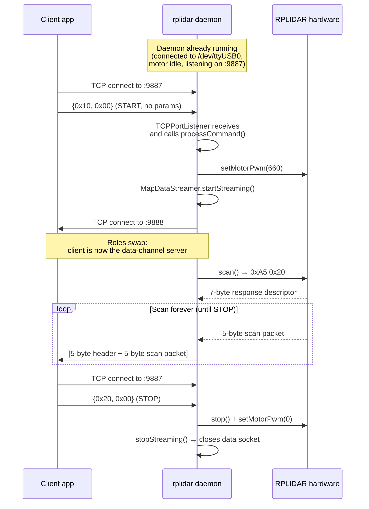

# 01 — What the driver does

## In one sentence

The driver is a **background daemon that turns an RPLIDAR laser scanner into two TCP sockets on localhost**: one you talk to, one it talks to you on.

## The bigger picture

An RPLIDAR (Slamtec's low-cost 360° laser scanner) is a USB device. Out of the box, the scanner speaks a custom **binary protocol over a virtual serial port** (`/dev/ttyUSB0`) at 115200 baud. Any program that wants scan data has to:

1. Open the serial port correctly (including the DTR trick to even let the motor spin).
2. Drive the hardware with the right request bytes (start scan, set motor PWM, stop).
3. Parse the response frames.

This driver hides all of that behind a network interface. Once it's running, *any* process on the same machine can kick off a scan by connecting to port 9887 and sending a single byte, and then receive scan data on port 9888 — without needing WiringPi, without knowing the RPLIDAR wire format, and without touching `/dev/ttyUSB0`.

## Inputs, processing, outputs

| Stage | Where | What happens |
|-------|-------|--------------|
| **Input** | TCP port **9887** (daemon is the server) | A client sends a 2-byte command header (`commandId`, `commandParameterLength`) optionally followed by parameters. Three command IDs are recognised: `0x10` START, `0x20` STOP, `0x99` TERMINATE. |
| **Hardware I/O** | `/dev/ttyUSB0` @ 115200 baud | The driver writes request bytes (`0xA5 | cmd | …`) and reads response descriptors + scan-data packets from the serial port. |
| **Processing** | In-process, in the `MapDataStreamer` thread | Scan packets (5 bytes each) are read one at a time. Either each packet is forwarded immediately (`SINGLE_PACKET_NORMAL`), or they are accumulated into an 8192-packet buffer and flushed once per revolution (`COMPLETE_SCAN_NORMAL`). **No angle/distance decoding, no filtering, no coordinate transforms** — the bytes are forwarded raw. |
| **Output** | TCP port **9888** (daemon is the client, connects *out* to the consumer) | Each payload is prefixed with a 5-byte framing header: `0xA5`, content-type byte, and a 24-bit big-endian payload size. |
| **Logging** | syslog (facility `LOCAL1`) | Lifecycle events, command receipts, and errors are all written via `syslog(3)`. No stdout output in normal operation. |

## End-to-end sequence

This is what happens from the moment a client connects until scan data starts arriving:

Two things in that diagram are worth staring at:

1. **There are two TCP connections, not one.** Commands go *into* the daemon on 9887; data comes *out* of the daemon on 9888 — and the daemon is the *client* of that data connection. That means whoever wants data has to run a TCP server on port 9888 first, *then* send START on 9887. This is covered in detail in [04-tcp-protocol.md](04-tcp-protocol.md).
2. **There is no handshake, no info exchange, no version negotiation.** A single START byte is enough to turn the whole pipeline on.

## What the driver explicitly does NOT do

- **No angle / distance decoding.** Every 5-byte RPLIDAR scan packet is forwarded byte-for-byte. The client is responsible for decoding them. Per Slamtec's protocol spec, the layout of one packet is:

  | Byte | Meaning |
  |------|---------|
  | 0 | Low 2 bits: `S` (new scan) and `!S` (its complement). Bits 2–7: quality (reflection strength). |
  | 1 | Bit 0: `C` (check bit, always 1). Bits 1–7: angle low bits. |
  | 2 | Angle high bits. Full angle in degrees = `((byte2 << 7) | (byte1 >> 1)) / 64.0` |
  | 3 | Distance low byte. |
  | 4 | Distance high byte. Full distance in mm = `((byte4 << 8) | byte3) / 4.0` |

  The driver just hands you `byte0..byte4` and walks away.

- **No filtering, clustering, or smoothing.** No outlier rejection. No rolling average. Nothing.
- **No coordinate-frame transforms.** Output is raw polar samples from the sensor's point of view.
- **No ROS / DDS / shared-memory integration.** TCP is the only transport.
- **No multi-client fanout.** Exactly one data consumer at a time.
- **No remote access.** Both ports bind to `127.0.0.1`, hardcoded. See [07-observations.md](07-observations.md).
- **No health monitoring loop.** The driver *has* a `getHealth()` implementation but never calls it.

## Why this design?

It is the simplest possible abstraction that lets other processes on the same Raspberry Pi use the lidar without linking WiringPi themselves or fighting with serial permissions. Everything downstream (mapping, visualisation, control) can be written in any language that can open a TCP socket, which makes the driver a clean teaching/research building block. The quirks are mostly consequences of that minimalism — see [07-observations.md](07-observations.md) for the honest list.

---

Next: [02-architecture.md](02-architecture.md) — how the code is structured internally.
