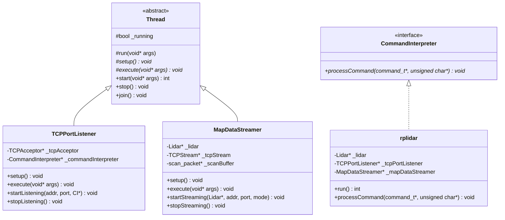
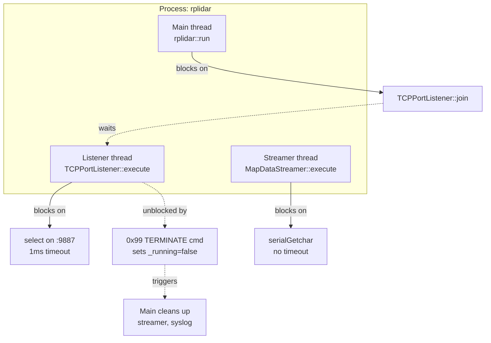
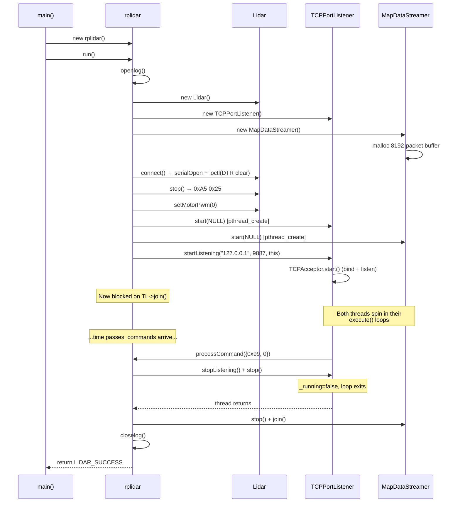
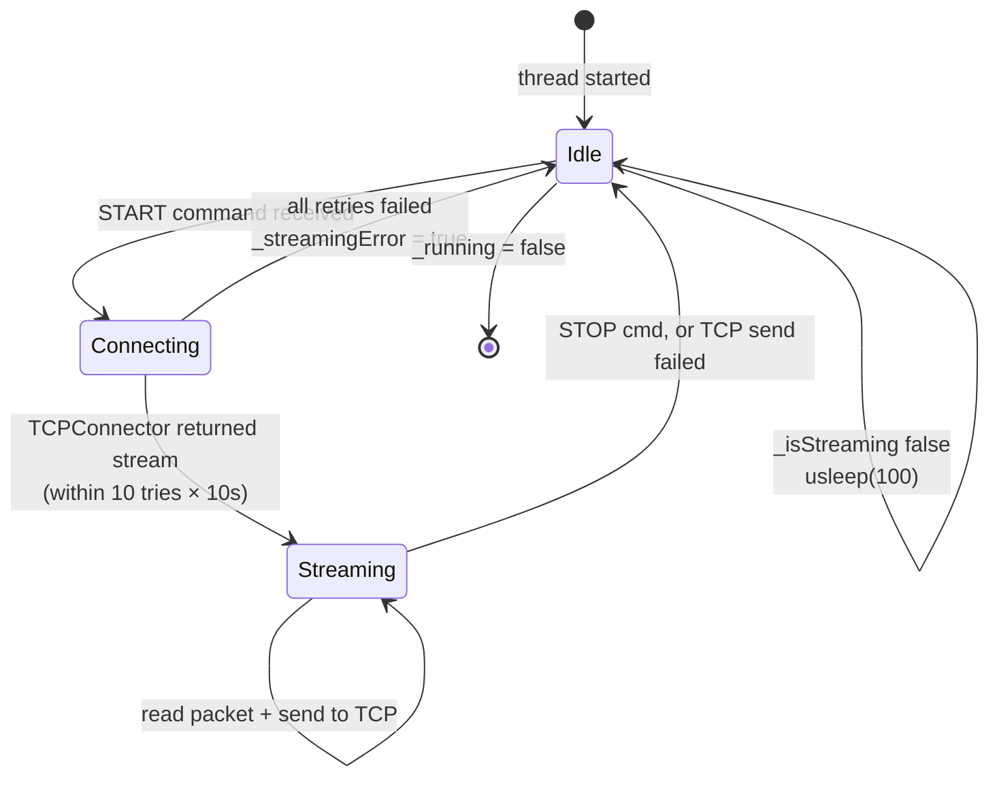

# 02 — Architecture

The driver is built out of a small number of objects that each own one concern: hardware, command I/O, data I/O, and threading. This document draws the map.

## Component diagram

```mermaid
graph LR
    subgraph HH["namespace hh (application)"]
        MAIN[rplidar<br/><i>main app</i>]
        LIDAR[Lidar<br/><i>serial hardware</i>]
        LISTENER[TCPPortListener<br/><i>command thread</i>]
        STREAMER[MapDataStreamer<br/><i>data thread</i>]
    end

    subgraph LIBCPP["namespace libcpp (reusable)"]
        THREAD[Thread<br/><i>pthread base</i>]
        ACCEPTOR[TCPAcceptor<br/><i>server socket</i>]
        CONNECTOR[TCPConnector<br/><i>client socket</i>]
        STREAM[TCPStream<br/><i>send/receive</i>]
    end

    subgraph INTERFACE["abstract"]
        CI[CommandInterpreter<br/><i>pure virtual</i>]
    end

    subgraph HW["hardware / OS"]
        SERIAL[/dev/ttyUSB0<br/><i>WiringPi serial</i>]
        TCP9887[(TCP :9887)]
        TCP9888[(TCP :9888)]
    end

    MAIN -->|owns| LIDAR
    MAIN -->|owns| LISTENER
    MAIN -->|owns| STREAMER
    MAIN -.implements.-> CI

    LIDAR -->|reads/writes| SERIAL

    LISTENER -->|inherits| THREAD
    LISTENER -->|owns| ACCEPTOR
    LISTENER -->|invokes| CI
    ACCEPTOR -->|accepts on| TCP9887
    ACCEPTOR -->|produces| STREAM

    STREAMER -->|inherits| THREAD
    STREAMER -->|uses| CONNECTOR
    STREAMER -->|reads from| LIDAR
    CONNECTOR -->|connects to| TCP9888
    CONNECTOR -->|produces| STREAM
```

A few things worth pulling out of that graph:

- The **`rplidar` class owns everything**. It is the only long-lived object in the program. It is also the only thing that implements `CommandInterpreter`, which is how it receives decoded commands back from the listener thread. See [src/rplidar.hpp:29](../src/rplidar.hpp#L29).
- **`Lidar` is not a thread.** It is a dumb synchronous wrapper around the serial port. Anybody who wants to read a packet calls `readNormalScanDataPacket()` and blocks until the bytes arrive. That "anybody" is the streamer thread.
- **Commands and data use completely different socket flows.** `TCPPortListener` uses `TCPAcceptor` (the daemon is the server). `MapDataStreamer` uses `TCPConnector` (the daemon is the client). See [04-tcp-protocol.md](04-tcp-protocol.md) for why.
- **`CommandInterpreter` is the one abstraction point.** Swap it out, and you can repurpose `TCPPortListener` for any other protocol. It is a pure virtual class with a single method — see [src/CommandInterpreter.hpp:32](../src/CommandInterpreter.hpp#L32).

## Class inheritance



The `Thread` class is what you'd expect from a textbook pthread wrapper: a static `threadEntryPoint` trampoline that casts `this` back to a `Thread*` and calls the virtual `execute()` hook. The `_running` flag is the cooperative shutdown signal. Subclasses override `setup()` (called once) and `execute()` (looped while `_running`). See [src/Thread.cpp:55-68](../src/Thread.cpp#L55-L68).

## Thread model

There are three concurrent actors in a running daemon:



### What each thread does

**Main thread** ([src/rplidar.cpp:51-86](../src/rplidar.cpp#L51-L86))
1. Opens syslog.
2. Allocates `Lidar`, `TCPPortListener`, `MapDataStreamer`.
3. Calls `lidar->connect()` / `stop()` / `setMotorPwm(0)` to bring the hardware to a known idle state.
4. Starts the two background threads.
5. Calls `tcpPortListener->startListening(...)` — which starts the `TCPAcceptor` and flips `_isListening` to true, but *does not* itself block.
6. Calls `tcpPortListener->join()` — **this** is the blocking call that parks the main thread until the listener thread terminates.
7. On unblock, shuts down the streamer, closes syslog, returns.

**Listener thread** ([src/TCPPortListener.cpp:35-75](../src/TCPPortListener.cpp#L35-L75))
1. Loops while `_running` is true and `_isListening` is true.
2. On each iteration: `tcpAcceptor->acceptPending()` polls with a 1ms `select()` timeout. If there's a pending connection, `accept()` returns a `TCPStream`.
3. Reads exactly 2 bytes into a `command_t` (the command ID + parameter length), then reads any parameter bytes.
4. Hands off to `_commandInterpreter->processCommand()` — which is the `rplidar::processCommand()` implementation.
5. Deletes the stream (closing the socket). Back to step 2.
6. When `_running` goes false (set by `rplidar::processCommand()` after receiving `0x99`), the loop exits.

**Streamer thread** ([src/MapDataStreamer.cpp:48-89](../src/MapDataStreamer.cpp#L48-L89))
1. Loops while `_running` is true.
2. If `_isStreaming` is true, calls `streamSinglePacketNormal()` or `streamCompleteScanNormal()` depending on mode.
3. If not streaming, sleeps 100µs and checks again.
4. On shutdown, stops looping.

### The blocking-read hazard

Note carefully what the streamer thread blocks on. Inside `streamSinglePacketNormal()`, the thread calls `_lidar->readNormalScanDataPacket()`, which in turn calls `serialGetchar()` five times. `serialGetchar()` is a **blocking** WiringPi call with **no timeout**. If the lidar ever stops sending bytes (unplugged, hung firmware, etc.), the streamer thread is stuck in a kernel read forever. `_running = false` will not wake it up. You would need to send SIGKILL. This is called out again in [07-observations.md](07-observations.md).

## Object lifecycle



A clean shutdown is almost always initiated by a client sending `0x99`. The SysV init script's `stop` action bypasses this and just sends SIGTERM — see [06-build-and-deploy.md](06-build-and-deploy.md).

## What about the data-channel streamer?

Note that *starting* the streamer thread does not start streaming. The streamer thread is created on boot and spins in its idle loop (`usleep(100)`) until `_isStreaming` flips to true. That flip happens inside `MapDataStreamer::startStreaming()`, which is itself called from `rplidar::processCommand()` when a `0x10` START command arrives.

So the handoff looks like this:



Two important properties of this state machine:
- **`startStreaming()` runs on the listener thread, not the streamer thread.** It's a cross-thread hand-off via the `_isStreaming`/`_tcpStream` member variables. There is no mutex — this works only because writes to those members from the listener thread happen *before* the streamer thread notices `_isStreaming == true`, and they're never concurrently mutated. It is accidentally safe rather than principled.
- **On connect failure, the streamer sits in Idle forever.** The error flag is set but no retry is scheduled. A client must send another START to re-trigger the retry loop.

---

Next up:
- [03-rplidar-protocol.md](03-rplidar-protocol.md) — the hardware protocol the `Lidar` class speaks.
- [04-tcp-protocol.md](04-tcp-protocol.md) — the network protocol the listener and streamer speak.
