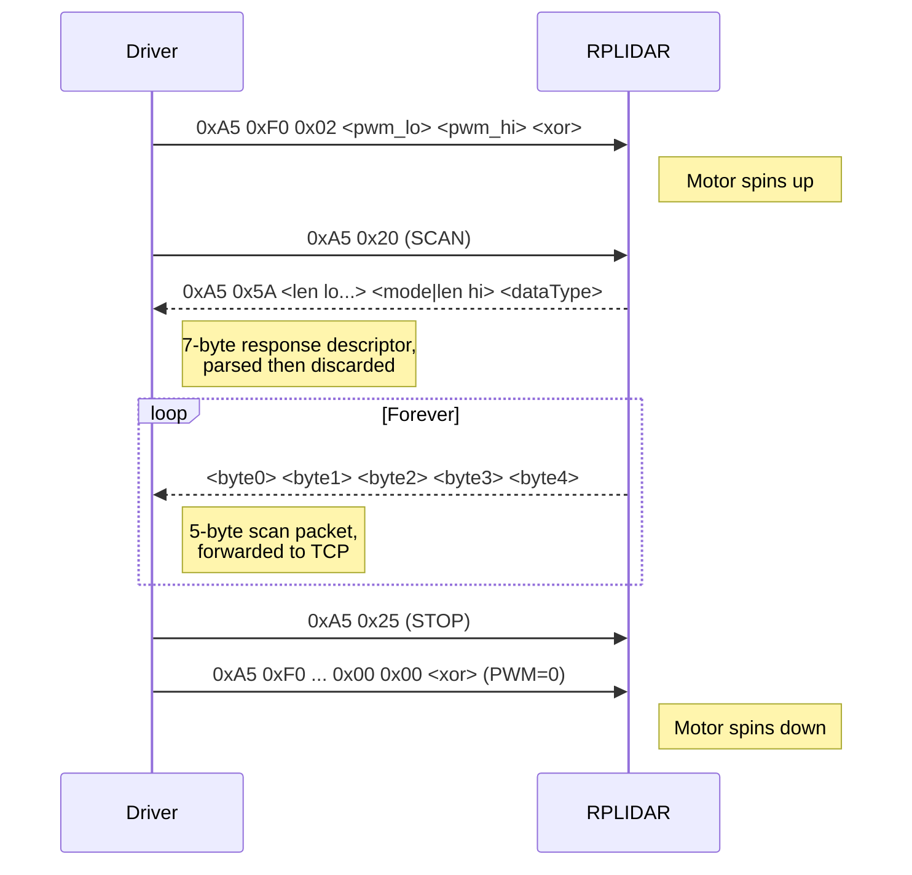

# 03 — RPLIDAR hardware protocol

This is how the driver talks to the actual laser scanner. All of the code for this lives in [src/Lidar.cpp](../src/Lidar.cpp) and [src/Lidar.hpp](../src/Lidar.hpp).

## Physical layer

The RPLIDAR enumerates as a virtual USB serial device (a CP210x or CH34x chip depending on the model). From the OS side, it's just a `/dev/ttyUSB*` node. The driver hardcodes the path in [src/Lidar.hpp:14](../src/Lidar.hpp#L14):

```cpp
#define LIDAR_SERIAL_DEVICE    "/dev/ttyUSB0"
#define LIDAR_SERIAL_BAUDRATE  115200
```

It uses **WiringPi's `serialOpen()`** ([src/Lidar.cpp:47](../src/Lidar.cpp#L47)) rather than raw `termios`, which is a Raspberry-Pi-ism — more on that in [06-build-and-deploy.md](06-build-and-deploy.md).

### The DTR trick

There is one non-obvious detail in `Lidar::connect()`:

```cpp
// For the motor to spin we have to clear the DTR line, this
// is not supported by wiringPi so we have to do that manually
uint32_t DTRBit = TIOCM_DTR;
ioctl(_serialHandle, TIOCMBIC, &DTRBit);
```

— [src/Lidar.cpp:53-56](../src/Lidar.cpp#L53-L56)

The USB-to-serial bridge chip controls the scanner's motor-enable line through the DTR pin. Most terminal emulators assert DTR when they open a port, which on the RPLIDAR *disables* the motor. WiringPi's serial helpers do not expose DTR control, so the code goes straight to `ioctl(TIOCMBIC)` (modem bit clear) to drop DTR after the port is open. If you skip this, the USB device will connect, commands will go through, but the motor will refuse to spin and you'll wonder why `scan()` returns no data. Worth remembering if you ever port this away from WiringPi.

## Request format

Every command the driver sends starts with a **request byte** (`0xA5`) followed by a **command code**:

```
┌──────┬──────┬─────────────────────┐
│ 0xA5 │ CMD  │ optional payload... │
└──────┴──────┴─────────────────────┘
  sync   code
```

The request sync byte is defined at [src/Lidar.hpp:17](../src/Lidar.hpp#L17) as `LIDAR_REQUEST`.

### Command codes

All nine codes the driver knows about, from [src/Lidar.hpp:19-27](../src/Lidar.hpp#L19-L27):

| Code | Name | What it does | Used by driver? |
|------|------|--------------|-----------------|
| `0x25` | `STOP_COMMAND` | Halt any current operation; lidar goes to idle. | Yes — called on startup and on STOP. |
| `0x40` | `RESET_COMMAND` | Soft-reset the device. | Implemented in `reset()` but never called. |
| `0x20` | `SCAN_COMMAND` | Start normal scan mode (5 bytes per sample). | Yes — called from `MapDataStreamer::startStreaming()`. |
| `0x82` | `EXPRESS_SCAN_COMMAND` | Start express scan mode (denser samples, different frame). | Stub only — `Lidar::expressScan()` does nothing. |
| `0x21` | `FORCE_SCAN_COMMAND` | Scan even if motor stopped. | Defined but not implemented anywhere. |
| `0x50` | `GET_INFO_COMMAND` | Return model/firmware/hardware/serial number. | Implemented in `getInfo()` but never called. |
| `0x52` | `GET_HEALTH_COMMAND` | Return device health status. | Implemented in `getHealth()` but never called. |
| `0x59` | `GET_SAMPLERATE_COMMAND` | Return standard + express sample rates. | Implemented in `getSampleRate()` but never called. |
| `0xF0` | `SET_MOTOR_PWM_COMMAND` | Set motor PWM 0..1023. | Yes — called on idle / START / STOP. |

So out of the nine commands, only **three are actually used** at runtime by the main application: STOP, SCAN, and SET_MOTOR_PWM. The others are scaffolding.

### Simple commands (no payload)

Most commands are just two bytes. `stop()`, for example ([src/Lidar.cpp:63-80](../src/Lidar.cpp#L63-L80)):

```cpp
serialPutchar(_serialHandle, LIDAR_REQUEST);    // 0xA5
serialPutchar(_serialHandle, LIDAR_STOP_COMMAND); // 0x25
delay(2);
serialFlush(_serialHandle);
```

The 2ms delay is from the RPLIDAR datasheet — the device needs a brief recovery window after STOP before it accepts the next command. Same pattern is used for `reset()` (with a 4ms delay), `scan()`, and the info-query methods.

### SET_MOTOR_PWM — the only command with a checksum

The motor-PWM command is the one case where a command carries a payload and a checksum. Construction is at [src/Lidar.cpp:264-281](../src/Lidar.cpp#L264-L281):

```
Byte 0: 0xA5                     ← request sync
Byte 1: 0xF0                     ← SET_MOTOR_PWM_COMMAND
Byte 2: 0x02                     ← payload length (always 2)
Byte 3: pwm & 0xFF               ← PWM low byte
Byte 4: (pwm >> 8) & 0xFF        ← PWM high byte
Byte 5: byte0 ^ byte1 ^ byte2    ← XOR checksum over all previous bytes
        ^ byte3 ^ byte4
```

PWM is clamped to `0..1023`. The constants in [src/Lidar.hpp:39-41](../src/Lidar.hpp#L39-L41) are `LIDAR_MAX_MOTOR_PWM=1023`, `LIDAR_DEFAULT_MOTOR_PWM=660`, and `LIDAR_IDLE_MOTOR_PWM=0`. 660 is the value the driver uses whenever it is "scanning normally" — that's how fast the head spins in `SINGLE_PACKET_NORMAL` mode by default.

Only this command uses the XOR checksum. None of the other commands carry one, and incoming scan packets don't either.

## Response descriptor

When a command returns a stream of data (`SCAN`, `GET_INFO`, `GET_HEALTH`, `GET_SAMPLERATE`, `EXPRESS_SCAN`), the device first emits a **7-byte response descriptor** telling you *what* is coming. The layout is defined in [src/Lidar.hpp:72-80](../src/Lidar.hpp#L72-L80) and parsed in [src/Lidar.cpp:190-216](../src/Lidar.cpp#L190-L216):

```
┌──────┬──────┬──────────────────────────────────────────────────┬────────┬──────┐
│ 0xA5 │ 0x5A │ dataLength (30 bits, little-endian)              │ mode   │ type │
└──────┴──────┴──────────────────────────────────────────────────┴────────┴──────┘
  flag1  flag2   bytes 2..5 (low bits of byte 5 are send mode)      2 bits   1 B
```

The clever/ugly bit is that bytes 2–5 encode a 30-bit data length, and the **top 2 bits of byte 5 are repurposed as a "send mode" field**. The parse code:

```cpp
response->dataLength = (receivedByte[5] >> 2) << 24 |
                       receivedByte[4] << 16 |
                       receivedByte[3] << 8 |
                       receivedByte[2];
response->sendMode = receivedByte[5] & 0x03;
response->dataType = receivedByte[6];
```

— [src/Lidar.cpp:207-212](../src/Lidar.cpp#L207-L212)

For a normal scan, the data length is actually *not meaningful* (the scan runs forever), but the descriptor still has to be consumed or the subsequent `serialGetchar()` calls will misalign. That's why `scan()` reads it and immediately discards it ([src/Lidar.cpp:250](../src/Lidar.cpp#L250)).

## Normal scan data packet

Once scan mode is running, the device emits a 5-byte packet per sample. The driver's in-memory representation is [src/Lidar.hpp:89-97](../src/Lidar.hpp#L89-L97):

```cpp
typedef struct {
    unsigned char byte0;
    unsigned char byte1;
    unsigned char byte2;
    unsigned char byte3;
    unsigned char byte4;
} lidar_normal_scan_data_packet_t;
```

The packet layout per the Slamtec spec is:

```
byte 0:  Q Q Q Q Q Q !S S      ← quality (6 bits), inverted new-scan, new-scan
byte 1:  A A A A A A A C       ← angle low (7 bits), check bit (always 1)
byte 2:  A A A A A A A A       ← angle high (8 bits)
byte 3:  D D D D D D D D       ← distance low (8 bits)
byte 4:  D D D D D D D D       ← distance high (8 bits)

angle   = ((byte2 << 7) | (byte1 >> 1)) / 64.0    [degrees]
distance= ((byte4 << 8) | byte3) / 4.0            [millimetres]
quality = byte0 >> 2
newScan = byte0 & 0x01                             ← 1 on first sample of a revolution
```

**The driver does not touch any of this decoding.** It reads the five raw bytes via [`readNormalScanDataPacket()`](../src/Lidar.cpp#L289-L310) and hands them to whoever is consuming. The only bit it *does* interpret is `byte0 & 0x01`, which `MapDataStreamer::streamCompleteScanNormal()` uses to detect the start of a new 360° revolution:

```cpp
if (scanData.byte0 & 0x01)   // new-scan bit set — flush buffered revolution
```

— [src/MapDataStreamer.cpp:120](../src/MapDataStreamer.cpp#L120)

That is the single place in the entire driver where a bit of the RPLIDAR payload is examined rather than blindly forwarded.

## Unused query responses

Three of the query-style commands are fully implemented but never called. They're worth skimming because they illustrate how the driver reads variable-length responses:

### `getHealth()` — [src/Lidar.cpp:129-157](../src/Lidar.cpp#L129-L157)

Sends `0xA5 0x52`, reads the 7-byte descriptor, then reads 3 bytes:

```
byte 0: status (0=OK, 1=warning, 2=error)
byte 1: errorCode low
byte 2: errorCode high   → errorCode = (byte2 << 8) | byte1
```

### `getSampleRate()` — [src/Lidar.cpp:160-187](../src/Lidar.cpp#L160-L187)

Sends `0xA5 0x59`, reads the descriptor, then reads 4 bytes → two little-endian 16-bit sample periods (standard and express, in microseconds per sample).

### `getInfo()` — [src/Lidar.cpp:103-126](../src/Lidar.cpp#L103-L126)

Sends `0xA5 0x50`, then *naively* drains up to 64 bytes from the port. Notably, this version does **not** read a response descriptor first — it just reads into a static buffer until either 64 bytes or `serialDataAvail()` returns false. Given that the device actually does send a descriptor for GET_INFO, this would skip the first 7 bytes of the actual payload if the timing happened to include the descriptor in the same read. Another reason these methods are probably unused in practice.

## Putting it all together — a normal scan session



That's the entire hardware protocol as actually exercised by the running daemon. Everything else in `Lidar.cpp` is scaffolding for commands the rest of the code never asks for.

---

Next: [04-tcp-protocol.md](04-tcp-protocol.md) — how the driver packages this data onto the wire.
