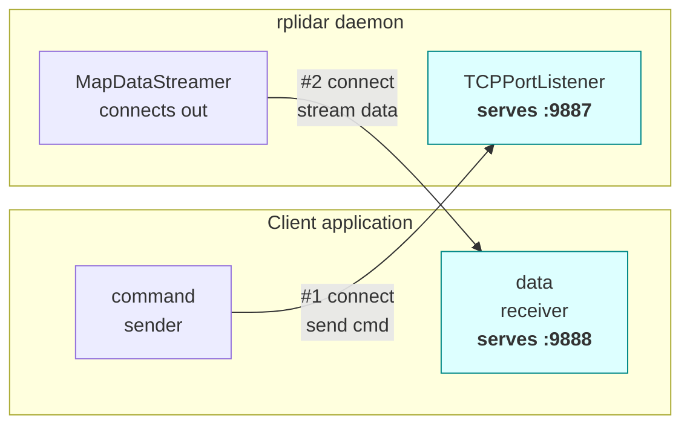
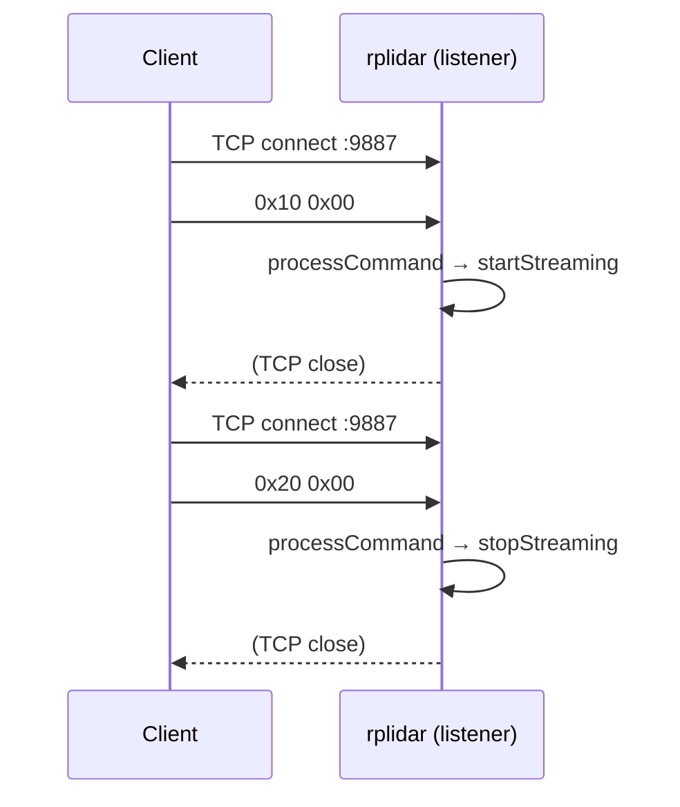
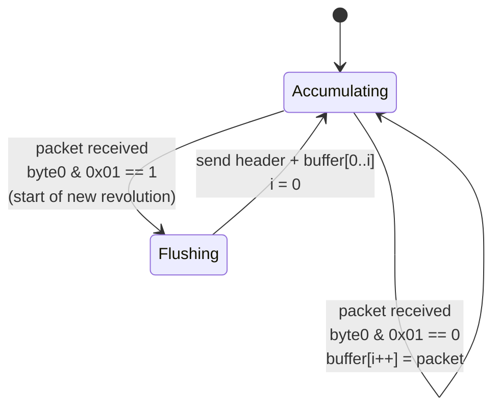
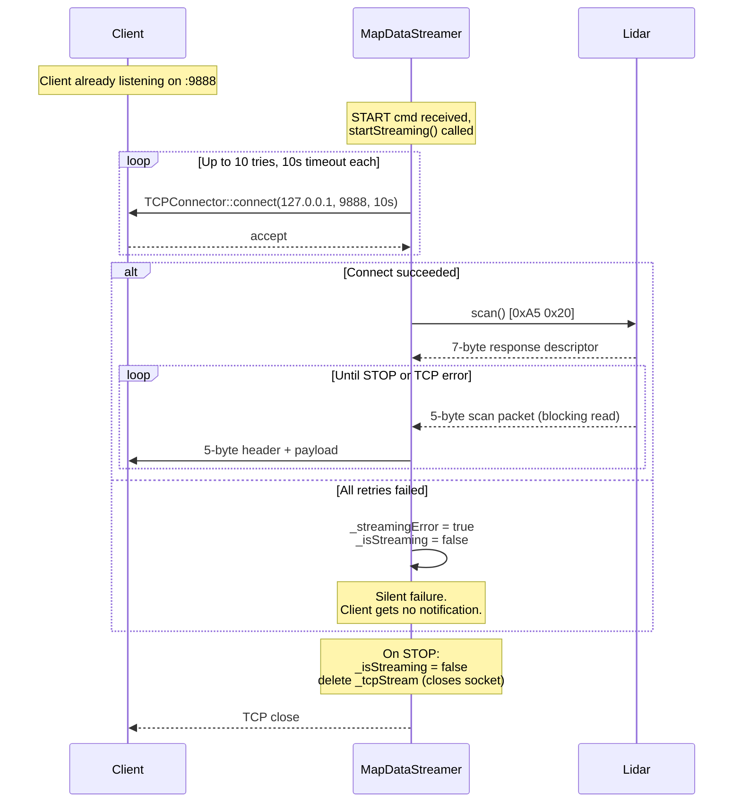

# 04 — TCP protocol

The driver talks to the outside world over **two TCP sockets on loopback**. This document covers both, plus the unusual role inversion between them.

## Two channels, opposite roles



This is the part that trips people up: **the daemon is the TCP client on the data channel, not the server.** To actually receive scan data, you have to:

1. Start a TCP server of your own, listening on `127.0.0.1:9888`.
2. *Then* send the START command (`0x10`) to `127.0.0.1:9887`.
3. The daemon will connect back to your server on 9888 and start writing framed packets.

Rationale isn't documented in the code, but it has some nice properties: the daemon doesn't have to worry about multi-client fanout, the data socket closes when your process exits, and the direction of the connection makes it obvious which process is in charge of the lifetime of the data stream.

The ports are hardcoded in [src/rplidar.hpp:16-19](../src/rplidar.hpp#L16-L19):

```cpp
#define DEFAULT_LIDAR_SERVER_TCP_ADDRESS "127.0.0.1"
#define DEFAULT_LIDAR_SERVER_TCP_PORT    9887
#define DEFAULT_LIDAR_CLIENT_TCP_ADDRESS "127.0.0.1"
#define DEFAULT_LIDAR_CLIENT_TCP_PORT    9888
```

Both are `127.0.0.1`. A remote machine cannot reach this daemon without recompilation.

## Channel 1 — Command channel (port 9887)

### Wire format

Every command is a **2-byte header** plus an optional parameter blob:

```
┌────────────┬─────────────────────────┬──────────────────────────────────┐
│ commandId  │ commandParameterLength  │ parameters[commandParameterLen]  │
│   1 byte   │        1 byte           │            0..255 bytes          │
└────────────┴─────────────────────────┴──────────────────────────────────┘
```

The 2-byte header is read directly into a `command_t` struct ([src/CommandInterpreter.hpp:15-20](../src/CommandInterpreter.hpp#L15-L20)):

```cpp
typedef struct {
    unsigned char commandId;
    unsigned char commandParameterLength;
} command_t;
```

The listener reads exactly 2 bytes into this struct, then, if `commandParameterLength > 0`, reads that many more bytes into a scratch buffer ([src/TCPPortListener.cpp:52-56](../src/TCPPortListener.cpp#L52-L56)):

```cpp
_tcpStream->receive((unsigned char *) &command, 2, 0);

if (command.commandParameterLength > 0)
    _tcpStream->receive((unsigned char *) commandParameters,
                        command.commandParameterLength, 0);
```

The parameter buffer is a fixed 256-byte stack array ([src/TCPPortListener.cpp:38](../src/TCPPortListener.cpp#L38)) — the size matches the max value of the 1-byte length field, so there is no overflow risk.

### Supported command IDs

Defined in [src/rplidar.hpp:12-14](../src/rplidar.hpp#L12-L14) and dispatched in [src/rplidar.cpp:15-49](../src/rplidar.cpp#L15-L49):

| ID | Name | Parameters | Effect |
|----|------|------------|--------|
| `0x10` | `LIDAR_COMMAND_START` | none (length=0) | Motor PWM → 660; data streamer connects to port 9888; hardware enters scan mode. |
| `0x20` | `LIDAR_COMMAND_STOP` | none | Data streamer stops; hardware sent STOP; motor PWM → 0. |
| `0x99` | `LIDAR_SERVER_TERMINATE` | none | Listener thread stops; main thread unblocks; daemon exits cleanly. |

Any other ID falls through the `default:` case in the switch with no error — it is silently ignored.

### Command session shape

Each command is a **one-shot connection**: the client connects, sends its 2-byte header (and parameters), and the daemon closes the socket when the handler returns ([src/TCPPortListener.cpp:62](../src/TCPPortListener.cpp#L62) — `delete _tcpStream`). There is no response. To send three commands, you open three connections.



The 1ms `select()` polling inside `TCPAcceptor::acceptPending()` ([src/TCPAcceptor.cpp:86-103](../src/TCPAcceptor.cpp#L86-L103)) is what makes the loop wake up quickly between connections without burning CPU.

## Channel 2 — Data channel (port 9888)

### Framing: the 5-byte streaming header

Every chunk of data the streamer writes is preceded by a **5-byte header**:

```
┌──────┬──────────────┬──────────────────────────────────┐
│ 0xA5 │ contentType  │        payload size (24-bit BE)  │
└──────┴──────────────┴──────────────────────────────────┘
  sync    1 byte                     3 bytes
```

Construction is in `MapDataStreamer::sendHeader()` at [src/MapDataStreamer.cpp:197-211](../src/MapDataStreamer.cpp#L197-L211):

```cpp
header[0] = STREAMING_HEADER_SYNC_BYTE;       // 0xA5
header[1] = contentType;
header[2] = (numberOfBytes >> 16) & 0xff;
header[3] = (numberOfBytes >> 8)  & 0xff;
header[4] =  numberOfBytes        & 0xff;
```

The size field is **big-endian**, which is different from the RPLIDAR hardware protocol (which is little-endian). Worth noting if you're writing a client parser.

### Content types

From [src/MapDataStreamer.hpp:25-33](../src/MapDataStreamer.hpp#L25-L33):

| Content type | Name | Meaning | Payload |
|--------------|------|---------|---------|
| `0x10` | `LIDAR_SINGLE_SCAN_PACKET` | One RPLIDAR sample | Exactly 5 raw bytes (`byte0..byte4`). |
| `0x15` | `LIDAR_COMPLETE_SCAN_PACKET` | One full 360° revolution | N × 5 bytes, where N is however many samples were in the revolution (typically 400–700 for A1, more for A2/A3). |
| `0x20` | `LIDAR_INFO_PACKET` | *Not implemented.* | — |
| `0x30` | `LIDAR_HEALTH_PACKET` | *Not implemented.* | — |
| `0x40` | `LIDAT_SAMPLE_RATE_PACKET` (sic) | *Not implemented.* | — |

The three unimplemented types are declared in the enum but never produced. Note the typo `LIDAT` in the enum name — it's faithfully preserved from the source.

### Streaming modes

The START command always uses `SINGLE_PACKET_NORMAL` by default (hardcoded in [src/rplidar.cpp:27](../src/rplidar.cpp#L27)), but `MapDataStreamer::startStreaming()` accepts a mode parameter and the other normal-speed mode is also implemented.

#### Mode 1: `SINGLE_PACKET_NORMAL`

Each sample is framed individually: header (5 bytes) + payload (5 bytes) = 10 bytes on the wire per sample.

```
┌──────┬──────┬──────┬──────┬──────┐ ┌──────────────────────────────┐
│ 0xA5 │ 0x10 │ 0x00 │ 0x00 │ 0x05 │ │  byte0 byte1 byte2 byte3 b4  │
└──────┴──────┴──────┴──────┴──────┘ └──────────────────────────────┘
              header (5)                      payload (5)
```

- **Overhead: 100%** — framing costs as much as the data.
- **Latency: microseconds** — each sample goes out the moment it's read.
- **Use case:** real-time visualisation, tight control loops.

Code path: [src/MapDataStreamer.cpp:92-107](../src/MapDataStreamer.cpp#L92-L107).

#### Mode 2: `COMPLETE_SCAN_NORMAL`

Samples are buffered until the next revolution's start bit is seen, then the entire previous revolution is flushed in a single write.

```
┌──────┬──────┬──────┬──────┬──────┐ ┌────────────────────────────────────────────┐
│ 0xA5 │ 0x15 │  size (24-bit BE)  │ │  N × (byte0 byte1 byte2 byte3 byte4)       │
└──────┴──────┴──────┴──────┴──────┘ └────────────────────────────────────────────┘
              header (5)                         payload (5N bytes)
```

- **Overhead: negligible** — 5 bytes of header per ~N×5 bytes of payload (N≈400–5000).
- **Latency: one revolution** (~100–200 ms at typical motor speeds).
- **Use case:** mapping, grid-based SLAM — anything that operates on whole revolutions.
- **Buffer cap:** 8192 samples per revolution ([src/MapDataStreamer.hpp:20](../src/MapDataStreamer.hpp#L20)). If the RPLIDAR somehow emitted more in one revolution, the excess would be silently dropped.

Code path: [src/MapDataStreamer.cpp:110-146](../src/MapDataStreamer.cpp#L110-L146).



Note the tiny latent bug here: on the very first packet, if the stream happens to start mid-revolution (start bit not set), the `sendBytes` variable is never initialised before the `if (sendBytes <= 0)` check at [src/MapDataStreamer.cpp:132](../src/MapDataStreamer.cpp#L132). In practice, this code path is only reached after a successful send, so the stale value is harmless *in the common case*, but it is technically an uninitialised read on the first iteration. See [07-observations.md](07-observations.md).

## Data channel connection lifecycle



The retry parameters are in [src/MapDataStreamer.hpp:17-19](../src/MapDataStreamer.hpp#L17-L19):

```cpp
#define STREAMER_CONNECT_TIMEOUT_SECONDS         10
#define STREAMER_CONNECT_TRIES                   10
#define STREAMER_WAIT_BETWEEN_CONNECT_RETRIES_US 10000
```

So the absolute worst case is a 100-second stall between a START command and giving up. In practice, if the client's server was up before START, the first attempt succeeds immediately.

## Minimum viable client, in pseudocode

```
# 1. Become the data server FIRST
data_server = tcp_listen("127.0.0.1", 9888)

# 2. Send START to the daemon
cmd_socket = tcp_connect("127.0.0.1", 9887)
cmd_socket.send(b"\x10\x00")
cmd_socket.close()

# 3. Accept the daemon's outbound data connection
data_socket = data_server.accept()

# 4. Read framed packets forever
while True:
    header = data_socket.recv_exactly(5)
    assert header[0] == 0xA5
    content_type = header[1]
    payload_size = (header[2] << 16) | (header[3] << 8) | header[4]
    payload = data_socket.recv_exactly(payload_size)
    # ... decode the 5-byte packets in payload ...

# 5. Send STOP
cmd_socket = tcp_connect("127.0.0.1", 9887)
cmd_socket.send(b"\x20\x00")
cmd_socket.close()
```

---

Next: [05-source-walkthrough.md](05-source-walkthrough.md) — per-file deep dive.
