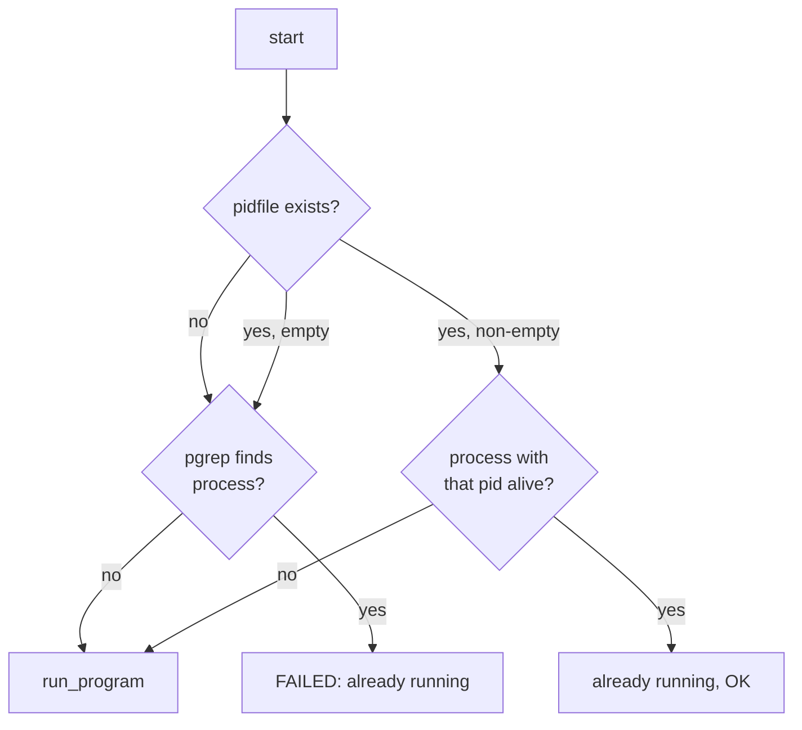

# 06 — Build and deploy

Everything in this document is about getting the binary built and running as a daemon. The actual driver logic is in [05-source-walkthrough.md](05-source-walkthrough.md).

## The makefile

Full source at [../makefile](../makefile). It's a generic C++ project makefile (the kind you find templated in tutorials) adapted to this project by filling in the settings block at the top:

```makefile
BIN_NAME      := rplidar
CXX           ?= g++
SRC_EXT       =  cpp
SRC_PATH      =  src
LIBS          =
COMPILE_FLAGS =  -std=c++11 -g
RCOMPILE_FLAGS=  -D NDEBUG
DCOMPILE_FLAGS=  -D DEBUG
INCLUDES      =  -I $(SRC_PATH)/
LINK_FLAGS    =  -lpthread -lwiringPi
DESTDIR       =  build
INSTALL_PREFIX=  /usr/local
```

— [makefile:1-30](../makefile#L1-L30)

### Targets

| Target | What it does |
|--------|--------------|
| `make release` | Builds optimised (`-D NDEBUG`) into `bin/release/rplidar` and symlinks it as `./rplidar` in the project root. |
| `make debug` | Same as release but with `-D DEBUG` instead. Goes to `bin/debug/rplidar`. |
| `make clean` | Removes the `build/`, `bin/`, the symlink, and any `*.log` files. |
| `make install` | `cp` the release binary to `/usr/local/bin/rplidar`. Requires root. |
| `make uninstall` | Removes `/usr/local/bin/rplidar`. |

Both `release` and `debug` depend on the `dirs` target, which creates `build/...` and `bin/...` subdirectories with `mkdir -p`.

### Source discovery

Sources are found automatically by globbing `src/*.cpp` ([makefile:78-92](../makefile#L78-L92)). On Linux, it uses a `find -printf` + `sort` pipeline to order sources by modification time (newest first), which makes the "most recently touched file compiles first" — a minor quality-of-life thing. There's a fallback recursive wildcard if `find` returns nothing.

### Link step

```makefile
$(BIN_PATH)/$(BIN_NAME): $(OBJECTS)
    @echo "Linking: $@"
    $(CMD_PREFIX)$(CXX) $(OBJECTS) $(LDFLAGS) -o $@
```

— [makefile:205-210](../makefile#L205-L210)

`LDFLAGS` = `-lpthread -lwiringPi`. That's the full link line.

### Git version injection

If the repo has a tag that `git describe` can resolve ([makefile:122-140](../makefile#L122-L140)), the makefile extracts `VERSION_MAJOR`, `VERSION_MINOR`, `VERSION_PATCH`, `VERSION_REVISION`, and `VERSION_HASH` from it and injects them as `-D VERSION_*=...` preprocessor macros. None of the source code actually references these macros, so it is dead scaffolding, but it's the kind of thing you'd notice in a `make -n` dry run.

## Dependencies

This is where building this project gets interesting on a non-Pi machine.

### WiringPi

The driver links against `-lwiringPi`, and `Lidar.cpp` `#include`s `<wiringPi.h>` + `<wiringSerial.h>`. **WiringPi is a Raspberry-Pi-only library** (originally by Gordon Henderson, deprecated around 2019, with community forks since). On a plain Linux desktop, `apt install wiringpi` will either fail outright or install a stub that does nothing useful.

If you want to build this on anything other than a Pi, your options are:

1. **Install an unofficial WiringPi port** (search "WiringPi unofficial mirror" or the `WiringPi/WiringPi` GitHub fork).
2. **Strip out WiringPi and rewrite `Lidar.cpp` to use `<termios.h>` directly** — it's a small file and the only four WiringPi symbols used are `serialOpen`, `serialPutchar`, `serialGetchar`, `serialFlush`, `serialDataAvail`, and `delay`. That's ~50 lines of rewrite.

Option 2 is what you'd do for a production port.

### pthread

Standard POSIX threads. Present on any Linux distro with a C++ toolchain.

### Runtime

- A `/dev/ttyUSB*` node with read/write permission for the running user. The init script runs as root, which sidesteps the permission issue entirely but is obviously a blunt instrument.
- An RPLIDAR plugged in.

## The init script

Full source at [../initdscript/rplidar](../initdscript/rplidar). This is a **System V init script** — the classic `/etc/init.d/foo {start|stop|restart|status}` style, which still works on most systemd-based distros via `systemd-sysv-generator` (systemd wraps the old script and makes `systemctl start rplidar` work).

### LSB header — [initdscript/rplidar:3-10](../initdscript/rplidar#L3-L10)

```
Provides:          TCP interface for rplidar laser scanner
Required-Start:    $local_fs $network $named $time $syslog
Required-Stop:     $local_fs $network $named $time $syslog
Default-Start:     2 3 4 5
Default-Stop:      0 1 6
```

- Runlevels `2 3 4 5` = multi-user (with/without network, with/without GUI). The daemon starts in all of these.
- Runlevels `0 1 6` = halt, single-user, reboot. The daemon stops in all of these.
- `Required-Start` lists syslog because the daemon relies on it for logging.

### Configuration — [initdscript/rplidar:13-17](../initdscript/rplidar#L13-L17)

```bash
servicename=rplidar
binary=/usr/local/bin/rplidar
pidfile=/var/run/rplidar/rplidar.pid
user=root
```

The `user=root` is mostly for `/dev/ttyUSB0` access and for the ability to write to `/var/run`. You could lower privileges by adding the service user to the `dialout` group and using `/run/user/<uid>/` for the pidfile, but the script doesn't bother.

### start — [initdscript/rplidar:102-138](../initdscript/rplidar#L102-L138)

Logic tree:



`run_program` ([initdscript/rplidar:81-90](../initdscript/rplidar#L81-L90)) is:

```bash
pid=`$program > /dev/null 2>&1 & echo $!`
echo $pid > $pidfile
sleep 1
check_pidproc
```

That is: launch the binary in the background, capture its PID via `$!`, write it to the pidfile, sleep a second, then verify the process is still alive. No `daemon(3)` / `setsid` / session detachment — it relies on the fact that shells detach backgrounded jobs when the parent script exits.

### stop — [initdscript/rplidar:140-161](../initdscript/rplidar#L140-L161)

1. Read pid from pidfile (or fall back to `pgrep`).
2. `check_pidproc` to verify it's actually running.
3. `kill $pid` — **plain SIGTERM**, no escalation to SIGKILL.
4. Remove the pidfile.

**Important caveat:** this `kill` does NOT send the `0x99` TERMINATE command over TCP. That means the daemon's own graceful-shutdown path (listener stop → join → streamer stop → syslog close) is *never* exercised by `service rplidar stop`. Instead, the daemon receives SIGTERM, and because it installs no signal handler, the default kernel action kicks in: the process is terminated immediately. The two background threads get cleaned up by the kernel, the serial port gets closed by `close(2)` on exit, and the TCP sockets get reset. In practice this is fine — the RPLIDAR will just keep spinning until its next power cycle, which is an annoying quirk but not a safety issue.

If you want a clean stop, send `0x99` to port 9887 instead of using the init script:

```bash
printf '\x99\x00' | nc 127.0.0.1 9887
```

### status — [initdscript/rplidar:163-177](../initdscript/rplidar#L163-L177)

Same logic as start's "is it already running?" branch, but only reports.

### Bugs noted in the script itself

Three `TODO` comments are present in the source ([line 74](../initdscript/rplidar#L74), [line 155](../initdscript/rplidar#L155), [line 169](../initdscript/rplidar#L169)):

- `# TODO: Not sure this condition is working` — on the pidfile-empty check. The condition (`[ -n "$pid" ]`) is actually correct; the comment is a false alarm.
- `# TODO: If kill fails because wrong PID in file PIDFile not removed.` — stop unconditionally removes the pidfile after `kill` without checking `kill`'s exit code.
- `# TODO: IF PIDFile has wrong PID this fails` — in `status`, same class of issue.

None of these are critical. They're the kind of thing that would bite you if someone manually fiddled with `/var/run/rplidar/rplidar.pid`.

## Putting it all together — a full deploy

On a Raspberry Pi with WiringPi already installed:

```bash
cd professors-libs/rplidar
make release
sudo make install                                    # → /usr/local/bin/rplidar
sudo cp initdscript/rplidar /etc/init.d/rplidar
sudo chmod +x /etc/init.d/rplidar
sudo update-rc.d rplidar defaults                    # register runlevels 2-5
sudo service rplidar start
sudo tail -f /var/log/syslog | grep rplidar          # watch it come up
```

To verify it's listening:

```bash
ss -tlnp | grep 9887
```

You should see `127.0.0.1:9887` in LISTEN state. Port 9888 is NOT listening in the daemon — remember, the daemon connects *out* on 9888 only after receiving a START command, and only if something is already listening on that port.

---

Next: [07-observations.md](07-observations.md) — the honest list of quirks and limitations.
